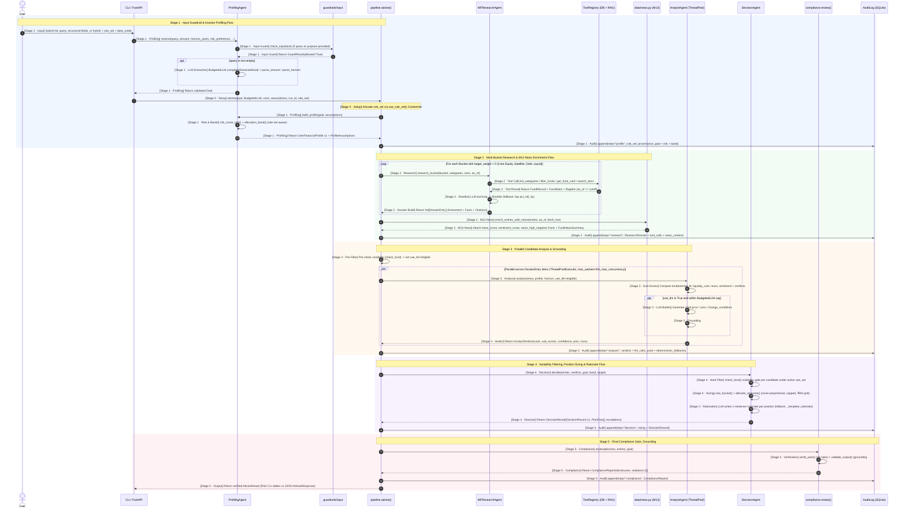
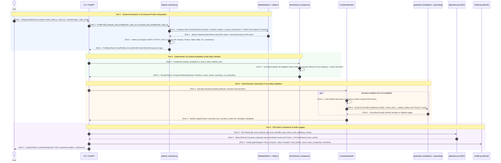
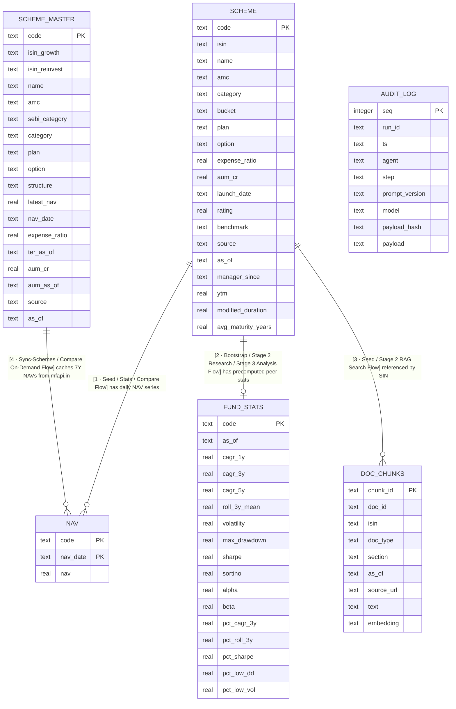
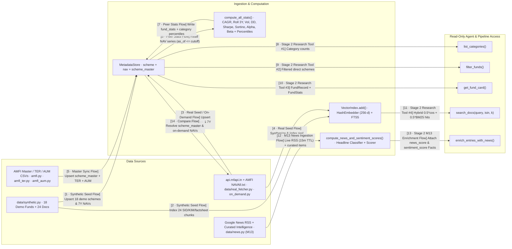
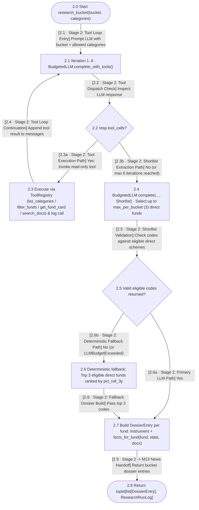
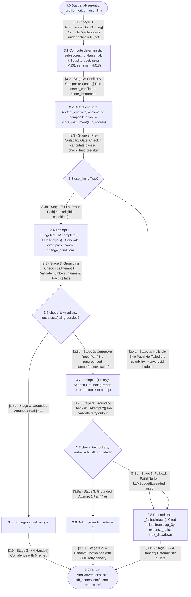
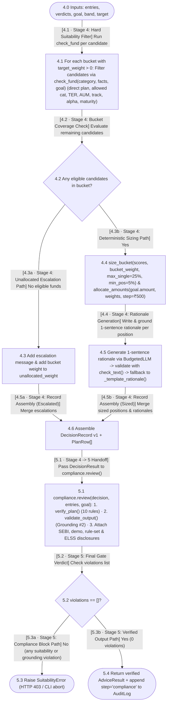

# AI Personal Wealth Manager — Architecture

End-to-end architecture of the AI Personal Wealth Manager: an Indian mutual-fund advisory and head-to-head comparison system combining **deterministic financial computation**, **switchable fund-selection rule sets** (`set1`, `set2`, `combined`), **dual data modes** (`synthetic` and `real` AMFI/MFAPI data), **real-time news and market sentiment intelligence (M13)**, **bounded LLM agents with strict call budgets**, and **hard compliance and grounding guardrails**, exposed via both a CLI (`wealth-advisor`) and a FastAPI backend (`wealth_advisor.api.main:app`).

---

## 1. Design principles

1. **Deterministic math, bounded LLM** — All numeric work (CAGR, rolling returns, Sharpe, Sortino, Jensen's alpha, beta, tracking error, rolling consistency, risk score, sub-scores, allocation bands, position sizing, rupee rounding, and head-to-head fund comparison) is pure Python (`domain/`). The LLM is restricted to:
   - extracting raw phrases from user input (or bypassed when structured inputs are provided),
   - issuing read-only tool calls to shortlist candidate funds,
   - writing cited `pros` / `cons` / `change_conditions` bullets,
   - writing a 2–4 sentence cited comparison narrative (`CompareNarrator`),
   - writing a one-sentence cited rationale per recommended fund.
2. **Evidence-first (Dossier-only downstream)** — Downstream agents (`AnalystAgent`, `DecisionAgent`, `CompareNarrator`) never query the database or web directly; they only see the `ResearchDossier` (a list of `DossierEntry` objects carrying `Fact` + `Citation` pairs, enriched with M13 news and sentiment facts) or computed `ComparisonResult` facts.
3. **Two-layer anti-hallucination** — Every number, fund name, and `[Fact.id]` citation in LLM prose is checked against the dossier by `guardrails/grounding.py`, first inside `AnalystAgent` / `CompareNarrator` (with 1 corrective retry + deterministic fallback) and again at the final `compliance.review` gate (`guardrails/compliance.py`). Promotional terms (`guaranteed`, `risk-free`, `assured`, `multibagger`, `sure-shot`) are scrubbed via `compliance.scrub()`.
4. **Hard suitability & compliance gate** — `guardrails/suitability.py` enforces 10 hard rules (direct-plan only, active-rule-set allowed categories, expense ceiling, AUM floor, track-record floor, positive-alpha requirement for active equity under Set 2/Combined, debt duration/maturity matching to horizon, single-fund cap, AMC concentration cap, and bucket band bounds) before any recommendation is returned.
5. **Switchable, auditable rule sets** — Three rule sets (`set1` Default, `set2` Magic of Mutual Funds, and `combined` deterministic merge) govern category universes, filters, scoring weights, and allocation bands via a request-scoped `ContextVar` (`use_rule_set`). Every run records the active rule set (and per-parameter provenance for `combined`) in the audit log and restores it during `replay`.
6. **Strict LLM call budgeting & graceful degradation** — `BudgetedLLM` (`llm/base.py`) enforces a thread-safe per-run call ceiling (`max_llm_calls_per_run`, default 12). Pre-suitability checks skip LLM prose for ineligible candidates, and if the budget is exhausted mid-run, `MFResearchAgent` and `AnalystAgent` automatically fall back to deterministic ranking and bullet generation.
7. **Full replayability** — Every pipeline step (`profile`, `research`, `analysis`, `decision`, `compliance`, and `fund_compare`) appends a SHA-256-hashed entry to `audit_log`. `audit/replay.py` re-runs the deterministic core from logged inputs under the recorded `rule_set` and verifies bit-identical outputs.

---

## 2. High-level system architecture (layered view)

Every connection line is numbered and tagged with the flow it belongs to:
- **`[U1..U6 · Entry Flow]`** — User request dispatch from CLI or FastAPI
- **`[P0..P7 · Advisory Pipeline Flow]`** — `pipeline.advise()` orchestration across stages 1–5 + audit
- **`[S1..S5 · Stage 1..5 Agent-to-Domain Flow]`** — Agents invoking deterministic math, tools, and guardrails
- **`[C1..C2 · Compare Flow]`** — Head-to-head comparison narrator and grounding
- **`[R1..R5 · Rule-Set Governance Flow]`** — Active `RuleSetConfig` governing downstream modules
- **`[L1..L8 · LLM & Tracing Flow]`** — `BudgetedLLM` routing to LangChain / ScriptedLLM / Langfuse
- **`[D1..D12 · Data Ingestion & Storage Flow]`** — Bootstrap, live feeds, and SQLite persistence

```mermaid
flowchart TB
    subgraph UX["Interface Layer"]
        CLI["CLI (typer + rich) · cli.py"]
        API["FastAPI Backend · api/main.py"]
    end

    subgraph ORCH["Orchestration Layer"]
        PIPE["Pipeline Orchestrator · pipeline.py :: advise()"]
        BOOT["Bootstrap & Data Sync · bootstrap.py"]
        CTX["Context & Tracing · logging_setup.py · trace_context · use_rule_set"]
    end

    subgraph GUARD_IN["Input Guardrail"]
        GIN["guardrails/input.py · check_input()"]
    end

    subgraph AGENTS["Agent Layer (agents/)"]
        PROF["1. ProfilingAgent · profiling.py (extract / resolve)"]
        RES["2. MFResearchAgent · mf_researcher.py"]
        ANA["3. AnalystAgent · analyst.py (parallel ThreadPool)"]
        DEC["4. DecisionAgent · decision.py"]
        CNAR["CompareNarrator · compare_narrator.py"]
        TOOLS["Read-Only Agent Tools · tools.py (ToolRegistry)"]
    end

    subgraph DOMAIN["Deterministic Core (domain/)"]
        RULES["Rule Sets & Merge Engine · rulesets.py · rule_merge.py · rule_catalog.py"]
        RISK["Risk Model · risk.py"]
        ALLOC["Allocation Bands & Target · allocation.py"]
        MET["NAV Metrics (CAGR, Sharpe, Alpha, Beta, TE) · metrics.py"]
        SUB["Sub-scores & Conflicts · subscores.py"]
        SCOR["Composite Score & Position Sizing · scoring.py"]
        CMP["Head-to-Head Fund Compare · fund_compare.py"]
        CAT["SEBI Categories (16) · categories.py"]
    end

    subgraph GUARD_OUT["Output Guardrails (guardrails/)"]
        GRND["Grounding Validator · grounding.py"]
        SUIT["Suitability Engine (10 rules) · suitability.py"]
        COMP["5. Compliance Gate & Scrub · compliance.py + disclosures.py"]
    end

    subgraph DATA["Data, News, RAG & Audit Layer"]
        STORE["MetadataStore (SQLite) · data/store.py"]
        REAL["Market Data Providers · data/real_fetcher.py · on_demand.py"]
        AMFI["AMFI Parsers (NAV, Master, TER, AUM) · amfi.py · amfi_ter.py · amfi_aum.py"]
        NEWS["News & Sentiment Engine (M13) · data/news.py"]
        STATS["Peer Percentile Stats · data/stats.py"]
        RAG["Hybrid Vector + FTS5 Index · rag/index.py"]
        AUDIT["Append-Only Audit Log & Replay · audit/log.py + audit/replay.py"]
    end

    subgraph LLM_LAYER["LLM & Observability Layer (llm/)"]
        FAC["get_llm() Factory + BudgetedLLM · llm/factory.py · llm/base.py"]
        LC["LangChainClient · llm/langchain_client.py"]
        SCR["ScriptedLLM (Offline / Tests) · llm/scripted.py"]
        LF["Langfuse v4 OTEL Span Processor (optional)"]
    end

    subgraph STORAGE["Local Persistence & External Feeds"]
        DB_SYN[("SQLite DB (Synthetic) · data/wealth_synthetic.db")]
        DB_REAL[("SQLite DB (Real) · data/wealth_real.db")]
        EXT["External Feeds · api.mfapi.in · AMFI NAVAll/TER/AUM · Google News RSS"]
    end

    CLI -->|"[U1 · Entry: Advise Flow] Invoke advise()"| PIPE
    CLI -->|"[U2 · Entry: Seed/Sync Flow] seed-demo / seed-real / sync-schemes"| BOOT
    CLI -->|"[U3 · Entry: Compare Flow] compare subcommand"| CMP
    API -->|"[U4 · Entry: Advise Flow] POST /api/advise"| PIPE
    API -->|"[U5 · Entry: Seed/Sync Flow] POST /api/data/sync"| BOOT
    API -->|"[U6 · Entry: Compare Flow] POST /api/compare"| CMP

    PIPE -->|"[P0 · Pipeline Setup] Bind run_id, trace_context & use_rule_set"| CTX
    PIPE -->|"[P1 · Stage 1: Input Guard] Validate user text"| GIN
    PIPE -->|"[P2 · Stage 1: Profiling] Build UserFinancialProfile v1"| PROF
    PIPE -->|"[P3 · Stage 2: Research] Shortlist per bucket"| RES
    PIPE -->|"[P4 · Stage 2: M13 News] enrich_entries_with_news()"| NEWS
    PIPE -->|"[P5 · Stage 3: Analysis] Parallel candidate scoring & bullets"| ANA
    PIPE -->|"[P6 · Stage 4: Decision] Filter, size & generate rationales"| DEC
    PIPE -->|"[P7 · Stage 5: Compliance] Final verify_plan + validate_output"| COMP
    PIPE -->|"[P8 · Audit Flow] Append SHA-256 step logs (steps 1..5)"| AUDIT

    PROF -->|"[S1.1 · Stage 1: Profiling] compute_risk_score()"| RISK
    PROF -->|"[S1.2 · Stage 1: Profiling] allocation_band() & target"| ALLOC
    RES -->|"[S2.1 · Stage 2: Research] Execute 4 read-only tools"| TOOLS
    TOOLS -->|"[S2.2 · Stage 2: Research] Query schemes, NAVs & stats"| STORE
    TOOLS -->|"[S2.3 · Stage 2: Research] Hybrid BM25 + vector search"| RAG
    ANA -->|"[S3.1 · Stage 3: Analysis] fundamental / fit / liquidity_cost"| SUB
    ANA -->|"[S3.2 · Stage 3: Analysis] score_instrument()"| SCOR
    ANA -->|"[S3.3 · Stage 3: Analysis] Grounding check #1 (check_text)"| GRND
    DEC -->|"[S4.1 · Stage 4: Decision] size_bucket() & allocate_amounts()"| SCOR
    CNAR -->|"[C1 · Compare Flow] Read ComparisonResult & facts"| CMP
    CNAR -->|"[C2 · Compare Flow] Grounding check on narrative"| GRND
    COMP -->|"[S5.1 · Stage 5: Compliance] verify_plan() (10 hard rules)"| SUIT
    COMP -->|"[S5.2 · Stage 5: Compliance] Grounding check #2 (validate_output)"| GRND

    RULES -.->|"[R1 · Rule Governance] Band ranges & horizon caps"| ALLOC
    RULES -.->|"[R2 · Rule Governance] Fundamental weights & fit bonuses"| SUB
    RULES -.->|"[R3 · Rule Governance] Analyst composite weights"| SCOR
    RULES -.->|"[R4 · Rule Governance] Allowed cats, AUM, alpha & maturity gates"| SUIT
    RULES -.->|"[R5 · Rule Governance] Bucket category universe"| RES

    PROF -->|"[L1 · Stage 1 LLM Flow] Extract goal phrases"| FAC
    RES -->|"[L2 · Stage 2 LLM Flow] Tool calls + Shortlist"| FAC
    ANA -->|"[L3 · Stage 3 LLM Flow] Cited pros/cons bullets"| FAC
    DEC -->|"[L4 · Stage 4 LLM Flow] 1-sentence position rationales"| FAC
    CNAR -->|"[L5 · Compare LLM Flow] 2-4 sentence verdict"| FAC
    FAC -->|"[L6 · Live LLM Routing] OpenAI / Anthropic / OpenRouter"| LC
    FAC -->|"[L7 · Offline LLM Routing] Deterministic regex/rules"| SCR
    LC -.->|"[L8 · Observability Flow] Export OTEL trace spans"| LF

    BOOT -->|"[D1 · Real Sync Flow] Fetch curated funds & 7Y NAVs"| REAL
    BOOT -->|"[D2 · AMFI Sync Flow] Parse NAVAll, TER & AUM exports"| AMFI
    BOOT -->|"[D3 · Stats Flow] compute_all_stats() + percentiles"| STATS
    REAL -->|"[D4 · External Fetch] HTTPS GET api.mfapi.in"| EXT
    AMFI -->|"[D5 · External Fetch] HTTPS GET AMFI portal"| EXT
    NEWS -->|"[D6 · M13 News Flow] HTTPS GET Google News RSS"| EXT
    STORE -->|"[D7 · Persistence: Synthetic] Read/write schemes & stats"| DB_SYN
    STORE -->|"[D8 · Persistence: Real] Read/write schemes, master & NAVs"| DB_REAL
    RAG -->|"[D9 · Persistence: Synthetic] Read/write doc_chunks & doc_fts"| DB_SYN
    RAG -->|"[D10 · Persistence: Real] Read/write doc_chunks & doc_fts"| DB_REAL
    AUDIT -->|"[D11 · Persistence: Synthetic] Append/replay audit_log"| DB_SYN
    AUDIT -->|"[D12 · Persistence: Real] Append/replay audit_log"| DB_REAL
```



---

## 3. End-to-end request flows

### 3.1 Advisory flow (`advise`)

Each numbered interaction (`autonumber` 1–28) is prefixed with its pipeline stage (`[Stage 0 · Setup]`, `[Stage 1 · Profiling]`, `[Stage 2 · Research & M13 News]`, `[Stage 3 · Analysis]`, `[Stage 4 · Decision]`, `[Stage 5 · Compliance]`).



### 3.2 Head-to-head fund comparison flow (`compare`)

Each numbered interaction (`autonumber` 1–16) is tagged with its comparison flow stage (`[Part 1 · Scheme Resolution & On-Demand Metrics]`, `[Part 2 · Deterministic 18-Criteria Comparison]`, `[Part 3 · Cited Narrative & Grounding]`, `[Part 4 · M13 News Comparison & Audit]`).



---

## 4. Pipeline stages and trust boundaries

Each transition arrow is numbered `[1]` through `[10]` and labeled with the pipeline stage it belongs to:

```mermaid
flowchart LR
    U["0. Untrusted User Input · NL / Structured / Hybrid"] -->|"[1 · Stage 1: Input Guard Flow] Raw query & params"| B1{{"Boundary 1 · Input Guardrail + Parser"}}
    B1 -->|"[2 · Stage 1: Profiling Flow] Validated Goal + Profile v1"| G["1. Validated Goal + Profile v1"]
    G -->|"[3 · Stage 2: Research & M13 Flow] Bucket categories + as_of"| B2{{"Boundary 2 · Read-Only Tool Registry + M13 News Enricher"}}
    B2 -->|"[4 · Stage 2 -> 3 Handoff] DossierEntry[] (Facts + Citations + News)"| D["2. ResearchDossier (Facts + Citations + News)"]
    D -->|"[5 · Stage 3: Analysis Flow] Pre-suitability + BudgetedLLM + Grounding #1"| B3{{"Boundary 3 · Pre-Suitability + BudgetedLLM + Grounding Check #1"}}
    B3 -->|"[6 · Stage 3 -> 4 Handoff] AnalystVerdict[] (Scores + Cited Bullets)"| V["3. AnalystVerdict[] (Scores + Cited Bullets)"]
    V -->|"[7 · Stage 4: Decision Flow] check_fund + size_bucket + ₹500 grid"| B4{{"Boundary 4 · Deterministic Sizer + Suitability Filter"}}
    B4 -->|"[8 · Stage 4 -> 5 Handoff] DecisionRecord v1 + PlanRow[]"| P["4. DecisionResult (Plan + Record v1)"]
    P -->|"[9 · Stage 5: Compliance Flow] verify_plan (10 rules) + Grounding #2 + scrub"| B5{{"Boundary 5 · Compliance Gate (Suitability + Grounding #2)"}}
    B5 -->|"[10 · Stage 5: Output & Audit Flow] Verified AdviceResult + SHA-256 AuditLog"| O["5. Verified AdviceResult + Audit Trail"]
```



| Boundary | Enforced by | Guarantees |
|---|---|---|
| **1. Input** | `guardrails/input.py` + `agents/profiling.py` | Blocks guaranteed-return, insider/front-running, tax-evasion, non-MF (crypto/F&O/intraday/stock-tip), and prompt-injection inputs. Converts Indian number words (`lakh`, `crore`, `hazar`, `saal`, `mahine`) deterministically in Python; bypasses LLM extraction entirely when structured fields (`amount`, `horizon_years`, `risk_preference`) are supplied without a free-text query. |
| **2. Retrieval & News** | `agents/tools.py` (`ToolRegistry`) + `data/news.py` | Agents cannot run arbitrary SQL or HTTP calls. Every retrieved metric and M13 news/sentiment signal (`news_score`, `sentiment_score`, `news_high_negative`) is wrapped in a `Fact(id, name, value, citation)` with `as_of <= run.as_of`. |
| **3. Analyst Grounding & Budget** | `llm/base.py` (`BudgetedLLM`) + `guardrails/grounding.py` | Ineligible funds skip LLM calls (`use_llm=False`). `BudgetedLLM` caps total LLM calls per run (`max_llm_calls_per_run`). Every numeric token (within 2% relative or 0.05 absolute tolerance), fund name, and `[Fact.id]` citation in `pros`/`cons`/`change_conditions` must match the entry's `Fact` list; 1 retry on failure, then deterministic `_fallback(facts)`. |
| **4. Sizing & Suitability** | `domain/scoring.py` + `guardrails/suitability.py` | Position weights and rupee amounts are computed purely in Python (`size_bucket`, `allocate_amounts`) after filtering candidates through `check_fund` under the active rule set (`set1`, `set2`, or `combined`). |
| **5. Compliance Gate** | `guardrails/compliance.py` | Re-verifies the entire plan (`verify_plan`) and re-runs `check_text` on every recommendation's rationale (`validate_output`). Any violation raises `SuitabilityError` and blocks output. Appends mandatory SEBI, rule-set, and ELSS 3-year lock-in disclosures. |

---

## 5. Component reference

### 5.1 Interface & orchestration

| Module | Key symbols | Responsibility |
|---|---|---|
| `cli.py` | `seed-demo`, `seed-real`, `sync-schemes`, `advise`, `compare`, `rules`, `funds`, `audit`, `replay` | Typer CLI supporting `--mode {synthetic,real}`, `--rule-set {set1,set2,combined}`, structured/hybrid/NL flags on `advise` (`--amount`, `--horizon`, `--risk`, `--purpose`, `--exclude`), head-to-head `compare`, and rule-set inspection (`rules --compare`). |
| `api/main.py` | `app` (FastAPI) | REST API for web UI: `/api/config/data-mode`, `/api/config/rule-set`, `/api/rules`, `/api/rules/compare`, `/api/data/sync`, `/api/advise`, `/api/funds`, `/api/funds/{code}`, `/api/news`, `/api/compare/schemes`, `/api/compare/categories`, `/api/compare`, `/api/portfolio/upload`. |
| `pipeline.py` | `advise()`, `AdviceResult`, `BUCKET_CATEGORIES` | Runs the 5-stage advisory pipeline under a single `run_id`, active `rule_set` (`use_rule_set`), and `trace_context`, parallelizing `AnalystAgent` calls across a `ThreadPoolExecutor` (`llm_max_concurrency`). |
| `bootstrap.py` | `bootstrap_demo()`, `bootstrap_real()` | Seeds either the 18 synthetic funds + 24 RAG docs (`seed-demo`) or fetches curated real Indian mutual funds (`data/curated_funds.csv`) + 7Y historical NAVs + peer stats + synthesized RAG docs (`seed-real`). |
| `config.py` | `Settings`, `get_settings()` | `pydantic-settings` configuration (`WEALTH_` env prefix) covering LLM provider, `max_llm_calls_per_run`, `llm_max_concurrency`, `data_mode`, `fund_rule_set`, `real_data_provider`, `benchmark_proxy_codes`, `compare_weights`, and suitability thresholds. |
| `db.py` | `open_db()` | Opens SQLite with `WAL` journal mode, `foreign_keys=ON`, and initializes schema (`MetadataStore.init_schema`, `VectorIndex.init_schema`, `AuditLog.init_schema`). |

### 5.2 Agents (`src/wealth_advisor/agents/`)

| Agent / Module | Prompt version | LLM usage | Deterministic fallback |
|---|---|---|---|
| `ProfilingAgent` (`profiling.py`) | `profiling.v1` | `extract()` or `resolve()` calls `complete(..., ExtractedGoal)` when free-text `query` is provided; bypassed for pure structured inputs. `build_profile()` is 100% deterministic. | Returns `ProfilingResult(missing=[...])` for follow-up questions if amount, horizon, or risk cannot be parsed. |
| `MFResearchAgent` (`mf_researcher.py`) | `mf_research.v1` | Up to 6 iterations of `complete_with_tools` using `ToolRegistry` (`list_categories`, `filter_funds`, `get_fund_card`, `search_docs`), then structured `Shortlist`. | If tool loop produces no valid codes or `LLMBudgetExceeded` is raised, ranks eligible direct funds by `pct_roll_3y` (or rating) and takes top `max_per_bucket` (3). |
| `AnalystAgent` (`analyst.py`) | `analyst.v1` | 1 structured call (`LLMAnalysis`: `pros`, `cons`, `change_conditions`) per eligible candidate, plus at most 1 retry if `check_text` fails. Skipped (`use_llm=False`) if candidate fails pre-suitability. | `_fallback(facts)`: generates cited bullets directly from `cagr_3y`, `expense_ratio`, and `max_drawdown` facts. |
| `DecisionAgent` (`decision.py`) | `decision.v1` | 1 structured call (`RationaleList`) to write a one-sentence cited rationale per sized position, validated with `check_text`. | `_template_rationale(row, facts)`: deterministic sentence citing `[cagr_3y, expense_ratio, rating]` or `[cagr_3y, expense_ratio]`. |
| `CompareNarrator` (`compare_narrator.py`) | `compare_narrator.v1` | 1 structured call (`NarrativeOutput`) to write a 2–4 sentence head-to-head verdict citing `[CODE:metric]`, scrubbed via `compliance.scrub()` and validated with `check_text(..., require_citation_ids=True)` (+1 retry). | `template_verdict(result)`: deterministic cited summary of scores, top criteria wins, and category warnings. |
| `ToolRegistry` (`tools.py`) | — | Exposes the 4 read-only tools to `MFResearchAgent` and builds `Fact` + `Citation` lists via `facts_for_fund()`. | Pure Python over `MetadataStore` and `VectorIndex`. |

### 5.3 Guardrails (`src/wealth_advisor/guardrails/`)

| Module | Key functions | What it enforces |
|---|---|---|
| `input.py` | `check_input()` | Regex patterns blocking guaranteed-return promises, insider/manipulation requests, tax evasion, crypto/F&O/intraday/stock tips, and prompt injection (`ignore previous instructions`, `bypass compliance`, etc.). |
| `grounding.py` | `check_text()`, `GroundingReport` | Extracts all numbers, `%` values, `X.XXx` multiples, `[citation_id]` tags, and capitalized `... Fund` names from text; verifies every number matches a `Fact.value` within 2% relative or 0.05 absolute tolerance, every citation ID exists, and every fund name is known. |
| `suitability.py` | `check_fund()`, `verify_plan()`, `SuitabilityError` | **Fund-level**: `direct_plan_only`, `allowed_categories` (rule-set specific), `expense_ceiling`, `min_aum` (`500 Cr` Set 1/Combined, `1000 Cr` Set 2), `min_track_years` (`3y`), `require_positive_alpha` (Set 2/Combined active equity), `match_maturity_to_horizon` (Set 2/Combined debt funds). **Plan-level**: `single_fund_cap` (<= 25%), `amc_concentration_cap` (<= 40%), `bucket_band` (bucket totals within `AllocationBand` or `horizon < 1y` equity=0 rule). |
| `compliance.py` | `review()`, `validate_output()`, `scrub()` | Runs `verify_plan` + `validate_output`, scrubs banned promotional words (`guaranteed`, `risk-free`, `assured`, `multibagger`, `sure-shot`), attaches `DISCLOSURES` (`disclosures.py`), adds `DEMO_DISCLOSURE` if any citation source is `synthetic_demo`, appends active rule-set disclosures (`set1` / `set2` / `combined`), and adds statutory 3-year lock-in disclosure when `ELSS` funds are present. |

### 5.4 Deterministic domain core (`src/wealth_advisor/domain/`)

| Module | Key functions / classes | Responsibility |
|---|---|---|
| `rulesets.py` | `RuleSetConfig`, `SET1_DEFAULT`, `SET2_MAGIC_OF_MF`, `COMBINED_RULESET`, `use_rule_set()`, `get_active_rules()` | Defines and manages the 3 switchable fund-selection rule sets (`set1`, `set2`, `combined`) using a thread/async-safe `ContextVar` (`use_rule_set`) and process default (`set_active_rule_set`). |
| `rule_merge.py` | `merge_rule_sets()`, `ParameterProvenance` | Deterministically merges `SET1_DEFAULT` and `SET2_MAGIC_OF_MF` into `COMBINED_RULESET` across 8 explicit merge strategies (`stricter_min`, `stricter_max`, `longer_horizon`, `overlapping_range`, `union`, `either_true`, `blended_weights`, `set2_only`) with per-field provenance. |
| `rule_catalog.py` | `describe_rule_set()`, `compare_rule_sets()` | Serializes rule-set parameters, merge strategies, and side-by-side comparisons (`set1` vs `set2` vs `combined`) for the CLI (`rules`) and API (`/api/rules`). |
| `categories.py` | `CATEGORIES`, `BUCKET_BY_CATEGORY`, `EQUITY_CATEGORIES`, `DEBT_CATEGORIES` | Maps 16 SEBI mutual-fund categories across the 4 portfolio buckets (`core_equity`, `satellite`, `debt`, `liquid`). |
| `risk.py` | `RiskInputs`, `compute_risk_score()` | Weighted sum of 5 normalized factors in `[0, 100]`: horizon (0.30), risk preference (0.30), savings rate (0.15), income stability (0.15), emergency fund months (0.10), minus optional HHI concentration penalty (up to -10 pts). Maps score to 5 `RiskCategory` tiers. |
| `allocation.py` | `allocation_band()`, `target_allocation()` | Rule-set-aware base `[min, max]` % ranges per `(RiskCategory, Bucket)` plus horizon/emergency overrides (Set 1: `<1y` -> 0% equity, `<3y` -> <=30% equity; Set 2 / Combined: `<1y` -> 100% Liquid, `<3y` -> 0% equity, `<5y` -> <=30% Core Equity & 0% Satellite; `emergency_months < 3` -> >=20% Liquid). |
| `metrics.py` | `cagr()`, `rolling_returns()`, `annualized_volatility()`, `max_drawdown()`, `sharpe()`, `sortino()`, `beta()`, `alpha()`, `tracking_error()`, `calendar_returns()`, `rolling_consistency()` | Pure pandas/numpy time-series calculations over ascending daily NAV series (`TRADING_DAYS = 252`) and benchmark NAV series. |
| `subscores.py` | `fundamental_score()`, `fit_score()`, `liquidity_cost_score()`, `detect_conflicts()`, `confidence()` | Rule-set-aware `[0, 100]` sub-scores (6-component fundamental score supporting `pct_low_vol` and positive `alpha`; fit score with Set 2 trusted-AMC bonus, beta penalty, and debt duration matching; liquidity/cost score with Set 2 YTM outlier penalty), conflict detection, and confidence calculation. |
| `scoring.py` | `score_instrument()`, `size_bucket()`, `allocate_amounts()` | Rule-set-aware composite weighted score, iterative cap-and-redistribute position sizing within each bucket, and ₹500-grid rupee allocation. |
| `fund_compare.py` | `compare_funds()`, `build_checklist()`, `CRITERIA`, `NOT_EVALUATED` | Deterministic head-to-head comparison of two `FundProfile` objects across 18 weighted criteria (Course Notes S3–S19), same-category vs cross-category handling, 7-rule red-flag checklist, and explicit `NOT_EVALUATED` disclosures. |

### 5.5 Data, news, RAG & audit (`src/wealth_advisor/data/`, `rag/`, `audit/`)

| Module | Key classes / functions | Responsibility |
|---|---|---|
| `data/store.py` | `MetadataStore`, `FundRecord`, `FundStats`, `SchemeMasterRecord` | SQLite DAO for `scheme`, `nav`, `fund_stats`, and `scheme_master` + `scheme_master_fts` (FTS5 search). Enforces temporal cutoff (`as_of`) on NAV reads. |
| `data/real_fetcher.py` | `MarketDataProvider`, `MfapiAmfiProvider`, `AmfiOnlyProvider`, `YFinanceProvider`, `sync_real_data()` | Pluggable real-data ingestion: loads `data/curated_funds.csv`, fetches 7Y daily NAV histories concurrently from `https://api.mfapi.in/mf/{code}`, refreshes latest NAVs from AMFI `NAVAll.txt`, and computes peer stats. |
| `data/on_demand.py` | `compute_fund_profile()`, `ensure_nav()`, `FundProfile` | Builds a complete `FundProfile` for any scheme code in `scheme` or `scheme_master`, fetching and caching historical NAVs from `mfapi.in` on demand and computing benchmark-relative alpha, beta, tracking error, and rolling consistency. |
| `data/amfi.py`, `amfi_ter.py`, `amfi_aum.py` | `parse_amfi_master()`, `sync_scheme_master()`, `load_ter_into_master()`, `load_aum_into_master()` | Parses full AMFI open-ended scheme master (`NAVAll.txt`), SEBI TER CSV exports, and quarterly average AUM CSV exports into `scheme_master`. |
| `data/news.py` | `get_fund_news()`, `get_macro_and_regulatory_news()`, `enrich_entries_with_news()`, `classify_headline()` | **M13 News & Sentiment Engine**: fetches live Google News India RSS feeds (with 15-min TTL cache), classifies headlines by sentiment/materiality/scope, merges curated SEBI/RBI/AMFI/category/AMC intelligence, computes deterministic `news_score` and `sentiment_score` (`[0, 100]`), and enriches dossier entries with cited `Fact`s. |
| `data/stats.py` | `compute_all_stats()`, `percentile_ranks()` | Computes 1Y/3Y/5Y CAGR, 3Y rolling return mean, volatility, max drawdown, Sharpe, Sortino, benchmark-relative `alpha` and `beta`, and within-category percentile ranks (`pct_cagr_3y`, `pct_roll_3y`, `pct_sharpe`, `pct_low_dd`, `pct_low_vol`). |
| `rag/index.py` | `VectorIndex`, `DocChunk`, `RagHit`, `HashEmbedder` | Hybrid retrieval: 50% cosine similarity (256-dim deterministic SHA-256 token `HashEmbedder`) + 50% normalized SQLite FTS5 BM25 score, filtered by `isin` and `as_of <= cutoff`. |
| `audit/log.py` & `audit/replay.py` | `AuditLog`, `replay()` | Append-only `audit_log` table with SHA-256 payload hashes; `replay(conn, run_id)` restores the recorded `rule_set` and re-runs risk scoring, sub-scoring, and position sizing to verify deterministic reproducibility. |

### 5.6 LLM access & observability (`src/wealth_advisor/llm/`)

| Module | Key classes / functions | Responsibility |
|---|---|---|
| `llm/base.py` | `LLMClient`, `BudgetedLLM`, `LLMBudgetExceeded`, `ToolSpec`, `ToolCall` | Protocol for structured output (`complete`), tool-calling (`complete_with_tools`), and embeddings (`embed`), plus thread-safe `BudgetedLLM` wrapper enforcing `max_llm_calls_per_run`. |
| `llm/factory.py` | `get_llm()` | Selects `ScriptedLLM` when `llm_provider="scripted"` or when no API key is configured; otherwise instantiates `LangChainClient`. |
| `llm/langchain_client.py` | `LangChainClient`, `trace_context()`, `flush_langfuse()` | Wraps `ChatOpenAI` (OpenAI or OpenRouter) and `ChatAnthropic` via LangChain; attaches Langfuse v4 OpenTelemetry span attributes (`run_id`, `step`, `prompt_version`). |
| `llm/scripted.py` | `ScriptedLLM` | Deterministic regex/rule-based implementation of `LLMClient` used for offline execution and fast, reproducible tests. |

---

## 6. Data model & persistence

The system maintains two separate default SQLite databases selected by `data_mode` (`s.active_db_path(mode)`):
- **Synthetic mode**: `data/wealth_synthetic.db` (seeded via `seed-demo`)
- **Real mode**: `data/wealth_real.db` (seeded via `seed-real` and `sync-schemes`)

Each relationship line is numbered `[1]`–`[4]` and labeled with the data/pipeline flows that read or write it:



Virtual FTS5 tables `doc_fts` (over `doc_chunks`) and `scheme_master_fts` (over `scheme_master`) provide fast BM25 keyword search for RAG documents and full-universe AMFI scheme lookup.

### Key Pydantic domain contracts (`models/core.py`)

Each composition relationship is numbered `[1]`–`[7]` and labeled with the pipeline stage handoff it belongs to:

```mermaid
classDiagram
    class Goal {
        +float amount
        +float horizon_years
        +RiskPreference risk_preference
        +str purpose
        +list~str~ excluded_categories
    }
    class UserFinancialProfile {
        +str profile_id
        +int version
        +dict inputs
        +int risk_score
        +RiskCategory category
        +AllocationBand allocation_band
    }
    class Citation {
        +str source
        +str doc_id
        +date as_of
        +str section
    }
    class Fact {
        +str id
        +str name
        +float|str value
        +Citation citation
    }
    class DossierEntry {
        +Instrument instrument
        +list~Fact~ facts
        +str notes
    }
    class ResearchDossier {
        +list~DossierEntry~ mf
        +dict news_context
        +dict sentiment
    }
    class AnalystVerdict {
        +str instrument_id
        +float score
        +dict~str,float~ sub_scores
        +float confidence
        +list~str~ pros
        +list~str~ cons
        +list~str~ change_conditions
    }
    class Recommendation {
        +str instrument_id
        +Action action
        +float target_weight
        +str rationale
        +list~Citation~ citations
    }
    class DecisionRecord {
        +str decision_id
        +str profile_id
        +int profile_version
        +dict~Bucket,float~ target_allocation
        +list~Recommendation~ recommendations
        +float overall_confidence
    }

    Goal ..> UserFinancialProfile : "[1 · Stage 1: Profiling Flow] builds profile"
    Fact *-- Citation : "[2 · Stage 2: Research & M13 Flow] attaches provenance"
    DossierEntry *-- Fact : "[3 · Stage 2 -> 3 Handoff] bundles fund + news facts"
    ResearchDossier *-- DossierEntry : "[4 · Stage 2 -> 3/4 Handoff] collects bucket shortlists"
    DossierEntry ..> AnalystVerdict : "[5 · Stage 3: Analysis Flow] scored & grounded into"
    DecisionRecord *-- Recommendation : "[6 · Stage 4: Decision Flow] sizes & records positions"
    Recommendation *-- Citation : "[7 · Stage 5: Compliance Flow] verifies cited sources"
```

---

## 7. Switchable fund-selection rule sets (`set1`, `set2`, `combined`)

`domain/rulesets.py` and `domain/rule_merge.py` support three selectable rule sets that can be switched globally (`POST /api/config/rule-set`, `WEALTH_FUND_RULE_SET`) or per request (`--rule-set`, `use_rule_set(rule_set)`):

| Dimension | `set1` (Default Baseline) | `set2` (Magic of Mutual Funds) | `combined` (Deterministic Merge) |
|---|---|---|---|
| **Category Universe** | 9 baseline categories (`Large Cap`, `Flexi Cap`, `Index`, `Mid Cap`, `Short Duration`, `Corporate Bond`, `Dynamic Bond`, `Liquid`, `Overnight`) | All 16 SEBI categories (adds `Small Cap`, `Large & Mid Cap`, `ELSS`, `Aggressive Hybrid`, `Arbitrage`, `Banking & PSU`, `Gilt`) | **Union (16 categories)**: full 16-category universe |
| **AUM & Track Record Floors** | Min AUM `₹500 Cr` (`₹2,000 Cr` Liquid/Overnight), min track record `3 years`, min rating `4★` | Min AUM `₹1,000 Cr` (`₹2,000 Cr` Liquid/Overnight), min track record `3 years`, no star-rating filter (`0★`), manager tenure `>= 3 years` | **Stricter floor (`max`)**: Min AUM `₹1,000 Cr` (`₹2,000 Cr` Liquid/Overnight), min rating `4★`, manager tenure `>= 3 years` |
| **Risk & Alpha Filters** | No alpha or beta hard gate | Active equity requires `alpha > 0`; penalizes `beta > 1.2` (-12 fit pts); debt maturity matched to horizon; YTM outlier penalty (> peer median + 150 bps) | **Boolean OR (`either_true`) / Stricter**: enforces `alpha > 0` for active equity, `beta <= 1.2`, debt maturity matching, and YTM outlier penalty |
| **Trusted AMC Bonus** | Disabled (`0.0`) | `+5.0` fit-score bonus for 12 trusted AMCs (`TRUSTED_AMCS`) | Enabled (`+5.0` bonus for `TRUSTED_AMCS`) |
| **Short-Horizon Overrides** | `< 1y`: 0% equity (`>= 60%` Liquid); `< 3y`: total equity `<= 30%` | `< 1y`: 100% Liquid; `< 3y`: 0% equity (Debt + Liquid only); `< 5y`: Core Equity `<= 30%`, Satellite `0%` | **Longer horizon (`max`)**: `< 1y` 100% Liquid; `< 3y` 0% equity; `< 5y` Core Equity `<= 30%`, Satellite `0%` |
| **Allocation Bands** | Standard `[min, max]` bands per `(RiskCategory, Bucket)` | Stricter satellite caps & higher core equity floors for Growth/Aggressive | **Overlapping range (`[max(lo), min(hi)]`)**, falling back to lower-risk set on non-overlapping ranges |
| **Fundamental Sub-Score Weights** | `roll_3y: 0.35`, `sharpe: 0.25`, `low_dd: 0.20`, `cagr_3y: 0.20` | `roll_3y: 0.30`, `sharpe: 0.20`, `low_dd: 0.15`, `low_vol: 0.10`, `cagr_3y: 0.10`, `alpha: 0.15` | **Blended (`50/50` normalized)**: `roll_3y: 0.325`, `sharpe: 0.225`, `low_dd: 0.175`, `cagr_3y: 0.15`, `alpha: 0.075`, `low_vol: 0.05` |

---

## 8. Data ingestion, RAG, and M13 News & Sentiment architecture

Every line is numbered `[1]`–`[14]` and labeled with the ingestion or runtime query flow it belongs to:



- **Temporal isolation (`as_of`)**: `MetadataStore.nav_series(code, as_of=...)` and `VectorIndex.search(..., as_of=...)` filter out any data dated after the run's `as_of` date, preventing look-ahead bias during backtests and replays.
- **Hybrid RAG scoring (`rag/index.py`)**:
  $$\text{score}(q, d) = 0.5 \cdot \cos(\text{embed}(q), \text{embed}(d)) + 0.5 \cdot \frac{\text{BM25}(q, d)}{\max_{d'} \text{BM25}(q, d')}$$
- **M13 News & Market Sentiment (`data/news.py`)**:
  - Combines live Google News India RSS headlines (cached for 15 minutes when `live_news` is enabled in `real` mode) with curated RBI/SEBI/AMFI macro, category, and AMC intelligence.
  - Classifies each headline into `sentiment` (`positive`, `neutral`, `negative`), `materiality` (`high`, `medium`, `low`), and `scope` (`macro`, `regulatory`, `amc`, `category`, `scheme`).
  - Computes two `[0, 100]` scores per fund: `news_score` (weighted by materiality and scope, with an extra `-10` penalty if any high-materiality negative event is present) and `sentiment_score` (category/AMC/macro momentum), injected into each `DossierEntry` as cited `Fact`s (`{code}:news_score`, `{code}:sentiment_score`, `{code}:news_high_negative`).

---

## 9. Agent internal flows

### 9.1 `MFResearchAgent` tool-calling loop (`agents/mf_researcher.py`)

Each edge is numbered `[2.1]`–`[2.9]` within **Stage 2 (Research Flow)**:



### 9.2 `AnalystAgent` grounding & retry loop (`agents/analyst.py`)

Each edge is numbered `[3.1]`–`[3.12]` within **Stage 3 (Analysis & Grounding #1 Flow)**:



### 9.3 `DecisionAgent` sizing & compliance flow (`agents/decision.py` + `guardrails/compliance.py`)

Each edge is numbered `[4.1]`–`[5.4]` spanning **Stage 4 (Decision & Sizing Flow)** and **Stage 5 (Compliance Gate Flow)**:



---

## 10. Audit trail & deterministic replay (`audit/`)

Every run produces a unique `run_id` (12-char hex) and logs 5 sequential steps in `audit_log` for `advise` (`profile`, `research`, `analysis`, `decision`, `compliance`) or `compare` for `fund_compare`:

| Step | Agent | Logged payload highlights |
|---|---|---|
| `1. profile` | `profiling` | `rule_set`, `provenance` (when `rule_set == "combined"`), `goal`, `assumptions`, `risk` (`RiskInputs` + `RiskResult`), `profile` (`UserFinancialProfile` v1), `target_allocation` |
| `2. research` | `mf_research` | `rule_set`, `as_of`, per-bucket `runs` (every tool call + args + notes), full `ResearchDossier` (`mf` entries with `Fact`s + `Citation`s, `news_context`, `sentiment`) |
| `3. analysis` | `analyst` | `rule_set`, `verdicts` (`AnalystVerdict` list), `deterministic_fallbacks` (codes that skipped or fell back from LLM), `llm_calls_used`, `llm_calls_budget` |
| `4. decision` | `decision` | `rule_set`, `sizing` (per-bucket candidates + sized positions), `settings` (`max_single_fund_weight`, `min_position_weight`, `rounding_step`), `DecisionRecord` v1, `escalations`, `unallocated_weight` |
| `5. compliance` | `compliance` | `ComplianceReport` (`disclosures`, `violations`) |
| `compare` | `fund_compare` | `inputs` (`codes`, `narrative`, `data_mode`), `fact_ids`, `fact_hashes`, `ComparisonResult`, `news_comparison`, `narrative`, `narrative_mode` |

`audit/replay.py :: replay(conn, run_id)` reads steps 1–4, activates the logged `rule_set` via `use_rule_set(logged_rule_set)`, re-executes `compute_risk_score`, `allocation_band`, `target_allocation`, `fundamental_score`, `fit_score`, `liquidity_cost_score`, `score_instrument`, `size_bucket`, and `allocate_amounts`, and returns a `ReplayReport(ok=True, checks=..., mismatches=[])`.

---

## 11. Scoring & allocation formulas at a glance

- **Risk score (`domain/risk.py`)**:
  $$S_{\text{risk}} = \text{clip}_{[0,100]}\!\left(\text{round}\!\left(0.30 H + 0.30 P + 0.15 R_{\text{sav}} + 0.15 I_{\text{stab}} + 0.10 E_{\text{emg}} - P_{\text{HHI}}\right)\right)$$
  Mapped to: `Capital Preservation` (0–20), `Conservative` (21–40), `Moderate` (41–60), `Growth` (61–80), `Aggressive` (81–100).

- **Analyst sub-scores (`domain/subscores.py`)**:
  - `fundamental`: weighted average of peer percentile ranks (`pct_roll_3y`, `pct_sharpe`, `pct_low_dd`, `pct_cagr_3y`, plus `pct_low_vol` and normalized `alpha` under `set2` / `combined`).
  - `fit`: starts at 80; adjusts for category-risk alignment, short-horizon equity penalty, `set2` / `combined` high-beta penalty (`beta > 1.2` -> `-12`), debt duration vs horizon mismatch (`-18`), and `TRUSTED_AMCS` bonus (`+5`).
  - `liquidity_cost`: $0.6 \times \text{TER headroom score} + 0.4 \times \log_{10}(\text{AUM})$ score, minus `-15` under `set2` / `combined` if a debt fund's YTM exceeds peer median by `> 150 bps` (credit-risk proxy).
  - `news` & `sentiment`: computed by `data/news.py` (`compute_news_and_sentiment_scores`) from live RSS + curated intelligence.

- **Composite instrument score (`domain/scoring.py`)**:
  - **Set 1**: $S_{\text{fund}} = 0.35 F_{\text{fund}} + 0.25 F_{\text{fit}} + 0.15 F_{\text{liq}} + 0.15 F_{\text{news}} + 0.10 F_{\text{sent}}$
  - **Set 2**: $S_{\text{fund}} = 0.40 F_{\text{fund}} + 0.30 F_{\text{fit}} + 0.20 F_{\text{liq}} + 0.05 F_{\text{news}} + 0.05 F_{\text{sent}}$
  - **Combined**: $S_{\text{fund}} = 0.375 F_{\text{fund}} + 0.275 F_{\text{fit}} + 0.175 F_{\text{liq}} + 0.10 F_{\text{news}} + 0.075 F_{\text{sent}}$

- **Bucket position sizing (`domain/scoring.py :: size_bucket`)**:
  Selects up to `max_positions` (3) funds with positive scores, distributes `bucket_weight` proportionally to $S_{\text{fund}}$, iteratively caps each fund at `max_single_fund_weight` (25%), redistributes excess to uncapped funds, drops positions below `min_position_weight` (5%), and rounds rupee amounts to the nearest ₹500 (`allocate_amounts`), adjusting the largest position so the sum equals `round(goal.amount × allocated_weight / 100)` exactly.

---

## 12. Configuration (`config.py`)

All settings are loaded via `Settings(BaseSettings)` with environment prefix `WEALTH_`:

| Setting | Default | Purpose |
|---|---|---|
| `llm_provider` | `"openai"` | `"openai"`, `"anthropic"`, `"openrouter"`, or `"scripted"` |
| `llm_model` | `"gpt-4o-mini"` | Default model identifier passed to provider |
| `max_llm_calls_per_run` | `12` | Hard per-run ceiling enforced by `BudgetedLLM` before deterministic fallbacks activate |
| `llm_max_concurrency` | `4` | Max worker threads for parallel `AnalystAgent` execution in `pipeline.py` |
| `data_mode` | `"real"` | Default data mode (`"synthetic"` -> `data/wealth_synthetic.db`, `"real"` -> `data/wealth_real.db`) |
| `fund_rule_set` | `"set2"` | Default rule set (`"set1"`, `"set2"`, or `"combined"`) |
| `real_data_provider` | `"mfapi_amfi"` | Real market data provider (`"mfapi_amfi"`, `"amfi_only"`, `"yfinance"`) |
| `curated_funds_path` | `data/curated_funds.csv` | Curated Indian MF scheme universe for `seed-real` |
| `real_nav_history_years` | `7` | Trailing years of daily NAV history fetched from `mfapi.in` |
| `benchmark_proxy_codes` | `{"Large Cap": "120716", ...}` | Direct-plan index fund scheme codes used as benchmark proxies for alpha/beta/tracking error |
| `compare_weights` | `{"cagr_3y": 10.0, ...}` | 18 criterion weights for head-to-head comparison (`domain/fund_compare.py`) |
| `langfuse_public_key` / `secret_key` | `""` | Optional Langfuse v4 OpenTelemetry tracing credentials |
| `risk_free_rate` | `0.065` | Annualized risk-free rate (6.5%, India 91-day T-bill proxy) |
| `min_aum_cr` / `min_aum_liquid_cr` | `500.0` / `2000.0` | Baseline AUM floors (overridden dynamically by active rule set) |
| `max_single_fund_weight` / `max_amc_weight` | `25.0` / `40.0` | Plan-level concentration caps (%) |
| `rounding_step` | `500` | Rupee rounding granularity for final investment amounts |
| `max_stocks` / `max_stock_candidates` | `5` / `8` | Default direct-stock count sized / researched; AI notes override per run |
| `llm_budget_base` / `llm_budget_per_fund` / `llm_budget_cap` | `2` / `2` / `30` | AI-notes runs get `max(max_llm_calls_per_run, base + per_fund × funds)` LLM calls, capped |
| `custom_equity_pct` / `custom_debt_pct` / `custom_gold_pct` | `60` / `40` / `5` | Fixed split for AI-notes portfolios; gold is carved out of debt |
| `trend_view_path` / `trend_view_stale_days` | `data/trend_view.json` / `30` | Saved web research view for trendy stocks and when it counts as stale |
| `nse_full_universe_path` | `data/nse_equity_full.csv` | Full NSE EQUITY_L list used to validate web-suggested symbols |

---

## 12a. AI-notes portfolio spec (`PortfolioSpec`)

When the optional AI notes name specific funds or stocks, the request is turned into a validated `PortfolioSpec` and takes priority over default selection limits. Without such counts nothing changes (defaults: 3 funds per bucket, 5 stocks, risk-profile bands, gold included).

1. **Parse** — `ProfilingAgent` asks the LLM only for raw phrases (`fund_requests`, `stock_count`, `trendy_stock_count`, `include_gold`); `domain/portfolio_spec.py` maps wording to canonical categories (`flexi` → Flexi Cap, `debt` → best-ranked across all debt categories) and validates counts. `POST /api/advise/preview` returns the parsed spec so the UI can show "here is what I understood" before the run.
2. **"Only X"** — only the requested instruments appear. Equity/debt is 60/40 when both are requested (liquid counts as debt); equity-only or debt-only requests get 100%. Gold is added only when requested (or in default runs) and is taken out of debt. Equity is split 50/50 between funds and stocks.
3. **Selection** — `agents/fund_selector.py` picks the top-ranked eligible funds per requested category with no LLM call. `agents/web_stock_picker.py` takes `trendy_stock_count` stocks from the saved web trend view and fills the rest from the screened synced list (or all from the web view when every stock is trendy).
4. **Overrides** — context rules (`horizon`, `allowed_category`, `alpha`, `maturity`, stock horizon / risk-profile sleeve, band, single-holding and sector caps, bucket counts) are waived for requested items and listed in `spec_report.overrides`. Data-integrity rules (direct plan, missing data, expense ratio, AUM, track record) stay on; a requested fund that fails them is reported in `spec_report.shortfalls`.
5. **Web trend view** — `data/trend_view.py` builds a dated view of sectors and stocks from Google News headlines plus one LLM call. Every sector and stock must cite fetched headlines and every symbol must exist on NSE. Selection never uses prices. The "Refresh trend view" button calls `POST /api/trend-view/refresh`; a view older than `trend_view_stale_days` is flagged. Web picks are not fundamentally screened and carry an explicit disclosure.
6. **Audit and replay** — the spec, effective limits (`max_stocks`, caps) and report are stored in the `profile` and `decision` audit entries; `replay()` recomputes the custom target and sizing from them. Follow-up Q&A explains exclusions against the spec (`not_requested`).

---

## 13. Testing architecture (`tests/`)

The test suite mirrors the milestone and feature structure and runs 100% offline using `ScriptedLLM` and in-memory/temp SQLite databases:

- `test_m0_skeleton.py` — Settings, logging `run_id` context var, LangChain/Scripted LLM factory.
- `test_m1_metrics.py` — CAGR, rolling returns, volatility, max drawdown, Sharpe, Sortino, alpha, beta, tracking error, rolling consistency, and peer percentile calculations.
- `test_m2_data_rag.py` — AMFI parser, `MetadataStore` filters, temporal `as_of` cutoff, hybrid `VectorIndex` search + citation integrity.
- `test_m3_profiling.py` — Input guardrail rejections, Indian unit parsing (`lakh`, `crore`, `saal`, `mahine`), `resolve()` structured/hybrid/NL modes, deterministic risk score, and allocation bands.
- `test_m4_research.py` — `ToolRegistry` read-only tools, `MFResearchAgent` tool loop, deterministic fallback, and dossier citation attachment.
- `test_m5_analyst.py` — Sub-scores, conflict detection, grounding validator (`check_text`), retry loop, and deterministic fallback.
- `test_m6_decision_compliance.py` — Suitability rules, position sizing, rupee rounding, `compliance.review` gate, and `AuditLog` + `replay()` verification.
- `test_m7_e2e_cli.py` — Golden end-to-end scenarios across all risk profiles, rule sets, and CLI commands (`seed-demo`, `advise`, `compare`, `rules`, `funds`, `audit`, `replay`).

---

## 14. Known limits & extension points

| Current scope | Extension hook |
|---|---|
| Mutual funds only (16 SEBI categories across 4 buckets) | `InstrumentType` already defines `ETF`, `EQUITY`, `BOND`, `GOLD`; add corresponding bucket rules in `domain/categories.py` and researchers in `pipeline.py`. |
| Single-goal lump-sum sizing (+ ELSS lock-in disclosure) | Extend `Goal` and `scoring.py` to support multi-goal cash-flow schedules, SIP step-ups, and LTCG/STCG tax-lot optimization. |
| 5 comparison parameters marked `NOT_EVALUATED` | Populate exit load, portfolio turnover, underlying holdings overlap, SEBI riskometer level, and debt credit-rating mix in `scheme` / `scheme_master` from AMC monthly factsheets (`domain/fund_compare.py`). |
| Portfolio upload endpoint (`/api/portfolio/upload`) is a stub | Connect CAMS/KFintech CAS statement parser (M11/M14) to compute existing portfolio XIRR, HHI concentration, and rebalancing drift against `target_allocation`. |
| Hash-based embeddings (`HashEmbedder`) | Swap `VectorIndex(embedder=...)` with an OpenAI/local dense embedding model implementing the `Embedder` protocol in `rag/index.py`. |
