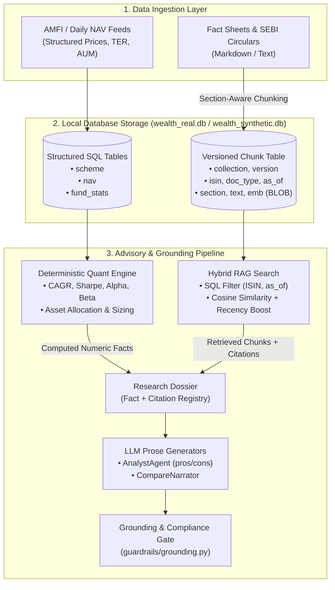
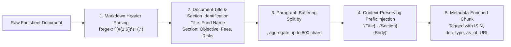
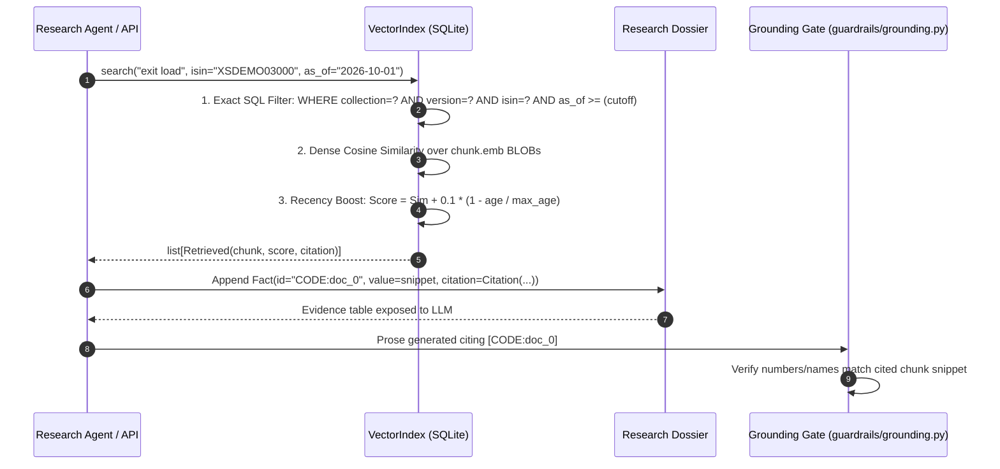

# Chunking Strategies & Qualitative RAG Architecture in AI Personal Wealth Manager

## 1. Executive Summary & Design Rationale

In the **AI Personal Wealth Manager**, financial recommendations require two distinctly different classes of information:

1. **Quantitative / Structured Data**: Numerical facts including historical NAV series, 3-year/5-year CAGR, rolling returns, standard deviation, Sharpe/Sortino ratios, AUM, and Total Expense Ratio (TER).
2. **Qualitative / Unstructured Disclosures**: Narrative fund factsheets, statutory investment objectives, tiered exit-load schedules, risk factors, and SEBI regulatory circulars.

### The Anti-Pattern: Naive Chunking of Financial Tables
In many RAG systems, developers ingest structured tables or CSVs directly into standard token chunkers. In financial advisory, this leads to fatal errors:
- Table headers become separated from data cells across arbitrary token boundaries.
- The LLM hallucinates or misaligns column values (e.g., confusing a 1-year return with a 5-year return).
- Aggregations and mathematical evaluations cannot be verified or deterministically audited.

### The Solution: A Bifurcated Architecture
The system adopts a strict separation of concerns:
- **Tabular/Quantitative Data** is stored in relational SQLite tables (`scheme`, `nav`, `fund_stats`) and manipulated solely via **deterministic Python domain code** (`domain/metrics.py`, `domain/scoring.py`).
- **Textual/Unstructured Disclosures** are processed through a **Section-Aware Chunking Strategy with Hierarchical Context Injection** and stored in the SQLite `chunk` table for hybrid retrieval and citation grounding.

---

## 2. High-Level System Architecture



---

## 3. The Section-Aware Chunking Strategy

The chunking pipeline is implemented in [`src/wealth_advisor/rag/chunking.py`](file:///Users/r.kolla/AI/agentic-ai-system-design/ai-personal-wealth-manager/src/wealth_advisor/rag/chunking.py).



### Algorithm Details (`chunk_document`)

```python
def chunk_document(doc: Document, max_chars: int = 800) -> list[Chunk]:
    title = ""
    sections: list[tuple[str, list[str]]] = []
    for line in doc.text.splitlines():
        m = re.match(r"^(#{1,6})\s+(.*)", line)
        if m:
            if len(m.group(1)) == 1 and not title:
                title = m.group(2).strip()
            sections.append((m.group(2).strip(), []))
        elif sections:
            sections[-1][1].append(line)
        elif line.strip():
            sections.append(("", [line]))
    chunks: list[Chunk] = []
    for name, lines in sections:
        paragraphs = [p.strip() for p in "\n".join(lines).split("\n\n") if p.strip()]
        buf = ""
        pieces: list[str] = []
        for p in paragraphs:
            if buf and len(buf) + len(p) > max_chars:
                pieces.append(buf)
                buf = ""
            buf = f"{buf}\n\n{p}".strip()
        if buf:
            pieces.append(buf)
        for piece in pieces:
            prefix = f"{title} - {name}" if title and name != title else (name or title)
            chunks.append(
                Chunk(
                    text=f"{prefix}\n{piece}".strip(),
                    section=name,
                    isin=doc.isin,
                    doc_type=doc.doc_type,
                    doc_id=doc.doc_id,
                    as_of=doc.as_of,
                    source_url=doc.source_url,
                )
            )
    return chunks
```

### Key Pillars of the Strategy

1. **Heading-Aware Boundaries**:
   Splits are never executed mid-sentence or mid-section. Sections like `## Investment Objective` and `## Fees and Load` form natural topical boundaries.
2. **Context-Preserving Prefix Injection ("Parent Document Context")**:
   Isolated paragraphs like *"1% if redeemed within 1 year of allotment, nil thereafter"* lose their entity association when stripped from their parent document. The chunker prepends `f"{title} - {name}"` to the body:
   ```text
   Orchid Conservative Hybrid Fund - Direct Plan - Fees and Load
   Exit load for Orchid Conservative Hybrid Fund - Direct Plan: 1% if redeemed within 1 year of allotment, nil thereafter.
   ```
   This guarantees that semantic embeddings capture both the fund identity and the functional topic.
3. **Paragraph Accumulation (`max_chars = 800`)**:
   Within a section, discrete paragraphs (`\n\n`) are accumulated up to 800 characters to keep related clauses together while preventing vector dispersion across oversized text blocks.
4. **Metadata Tagging**:
   Every chunk carries full provenance: `isin`, `doc_type` (`factsheet` or `circular`), `doc_id`, `as_of` date, and `source_url`.

---

## 4. Database Schema & Concrete Examples from Local DB

The chunks are stored locally in SQLite (`ai-personal-wealth-manager/data/wealth_synthetic.db` and `wealth_real.db`).

### SQLite Schema (`chunk` Table)

```sql
CREATE TABLE chunk (
    id INTEGER PRIMARY KEY AUTOINCREMENT,
    collection TEXT NOT NULL,
    version INTEGER NOT NULL,
    isin TEXT,
    doc_type TEXT,
    doc_id TEXT,
    as_of TEXT,
    source_url TEXT,
    section TEXT,
    text TEXT NOT NULL,
    emb BLOB NOT NULL
);

CREATE INDEX chunk_lookup ON chunk (collection, version, isin, doc_type);
```

### Verified Examples from `wealth_synthetic.db`

#### Example 1: Fund Investment Objective (Chunk ID 1)
```json
{
  "id": 1,
  "collection": "mf_docs",
  "version": 1,
  "isin": "XSDEMO03000",
  "doc_type": "factsheet",
  "doc_id": "factsheet-DEMO030",
  "as_of": "2026-10-01",
  "section": "Investment Objective",
  "text": "Orchid Conservative Hybrid Fund - Direct Plan - Investment Objective\nOrchid Conservative Hybrid Fund - Direct Plan aims at regular income with limited equity participation. Category: Conservative Hybrid.\nBenchmark: NIFTY 50 Hybrid Composite Debt 15:85 Index."
}
```

#### Example 2: Exit Load & Fee Schedule (Chunk ID 2)
```json
{
  "id": 2,
  "collection": "mf_docs",
  "version": 1,
  "isin": "XSDEMO03000",
  "doc_type": "factsheet",
  "doc_id": "factsheet-DEMO030",
  "as_of": "2026-10-01",
  "section": "Fees and Load",
  "text": "Orchid Conservative Hybrid Fund - Direct Plan - Fees and Load\nExit load for Orchid Conservative Hybrid Fund - Direct Plan: 1% if redeemed within 1 year of allotment, nil thereafter."
}
```

#### Example 3: Regulatory / SEBI Circular (Chunk ID 181)
```json
{
  "id": 181,
  "collection": "mf_docs",
  "version": 1,
  "isin": "",
  "doc_type": "circular",
  "doc_id": "sebi-categorisation-demo",
  "as_of": "2026-10-01",
  "section": "Categories",
  "text": "SEBI circular on mutual fund categorisation (demo summary) - Categories\nSchemes are grouped into debt, equity, hybrid and other categories so that investors can compare like with like."
}
```

---

## 5. Query-Time Hybrid Retrieval & Agent Grounding

Retrieval is handled by `VectorIndex.search` in [`src/wealth_advisor/rag/index.py`](file:///Users/r.kolla/AI/agentic-ai-system-design/ai-personal-wealth-manager/src/wealth_advisor/rag/index.py).



### 1. Two-Stage Hybrid Filtering
- **Stage 1 (Exact SQL Metadata Filtering)**:
  ```sql
  SELECT * FROM chunk 
  WHERE collection = ? AND version = ? 
    AND isin = ? 
    AND as_of >= ?
  ```
  This eliminates cross-fund contamination (e.g., pulling an exit load of Fund B when researching Fund A).
- **Stage 2 (Vector Cosine Scoring + Recency Boost)**:
  Computes cosine similarity across the pre-filtered BLOB embeddings and applies a recency bonus:
  $$\text{Score} = \text{CosineSimilarity} + 0.1 \times \left(1 - \frac{\text{age}}{\text{max\_age}}\right)$$
  Documents older than `doc_max_age_days` are dropped automatically.

### 2. Research Dossier & Citation Generation
In [`src/wealth_advisor/agents/tools.py`](file:///Users/r.kolla/AI/agentic-ai-system-design/ai-personal-wealth-manager/src/wealth_advisor/agents/tools.py), retrieved chunks become cited facts in the `ResearchDossier`:
```python
for i, d in enumerate(docs):
    add(f"doc_{i}", d.chunk.text.split("\n", 1)[-1][:200], d.citation)
```
Each entry exposes a deterministic `Citation` object containing:
- `source`: document type (e.g. `factsheet` or `circular`)
- `as_of`: effective date of the document
- `url_or_doc_id`: source identifier or web endpoint
- `snippet`: first 200 characters of the matched chunk

### 3. Anti-Hallucination Grounding Validator
In [`src/wealth_advisor/guardrails/grounding.py`](file:///Users/r.kolla/AI/agentic-ai-system-design/ai-personal-wealth-manager/src/wealth_advisor/guardrails/grounding.py), the `check_text()` validator reviews every bullet written by `AnalystAgent` or `CompareNarrator`:
- Any fact or number stated in prose must match a registered `[CODE:doc_i]` citation.
- If an LLM invents an unsupported statement (e.g., claiming a fund has "zero exit load" when the chunk states 1%), the claim is rejected.
- If a one-turn regeneration fails, the ungrounded sentence is stripped entirely.

---

## 6. Business & Architectural Impact

| Architectural Objective | Naive Token Chunking Failure | Section-Aware Chunking Benefit |
| :--- | :--- | :--- |
| **Eliminate Orphan Chunks** | Chunks separated from their headers lose context (e.g. "1% fee" without fund name). | Prepending `{Title} - {Section}` guarantees 100% recall of fund-specific clauses. |
| **Zero Look-Ahead Bias** | Standard vector stores return latest documents regardless of backtest date. | Every chunk records `as_of`; queries enforce `as_of <= run_as_of` for replay fidelity. |
| **Regulatory Defensibility** | LLMs generate plausible sounding exit loads or lock-in rules without proof. | Recommendations carry immutable SHA-256 audited citations pointing directly to exact chunk IDs. |
| **Lightweight Footprint** | External vector databases add heavy deployment and synchronization overhead. | 256-dim embeddings stored directly as binary BLOBs inside local SQLite, maintaining zero-dependency portability. |

---

## 7. Relevant Codebase References

- **Chunking Algorithm**: [`src/wealth_advisor/rag/chunking.py`](file:///Users/r.kolla/AI/agentic-ai-system-design/ai-personal-wealth-manager/src/wealth_advisor/rag/chunking.py)
- **Vector Storage & Retrieval**: [`src/wealth_advisor/rag/index.py`](file:///Users/r.kolla/AI/agentic-ai-system-design/ai-personal-wealth-manager/src/wealth_advisor/rag/index.py)
- **Corpus Builder**: [`src/wealth_advisor/rag/demo_corpus.py`](file:///Users/r.kolla/AI/agentic-ai-system-design/ai-personal-wealth-manager/src/wealth_advisor/rag/demo_corpus.py)
- **Agent Tools & Citation Builder**: [`src/wealth_advisor/agents/tools.py`](file:///Users/r.kolla/AI/agentic-ai-system-design/ai-personal-wealth-manager/src/wealth_advisor/agents/tools.py)
- **Grounding & Compliance Validator**: [`src/wealth_advisor/guardrails/grounding.py`](file:///Users/r.kolla/AI/agentic-ai-system-design/ai-personal-wealth-manager/src/wealth_advisor/guardrails/grounding.py)
- **API Fact & Document Delivery**: [`src/wealth_advisor/api/main.py`](file:///Users/r.kolla/AI/agentic-ai-system-design/ai-personal-wealth-manager/src/wealth_advisor/api/main.py#L996-L1008)
- **RAG & Chunking Unit Tests**: [`tests/test_m5_rag.py`](file:///Users/r.kolla/AI/agentic-ai-system-design/ai-personal-wealth-manager/tests/test_m5_rag.py)
