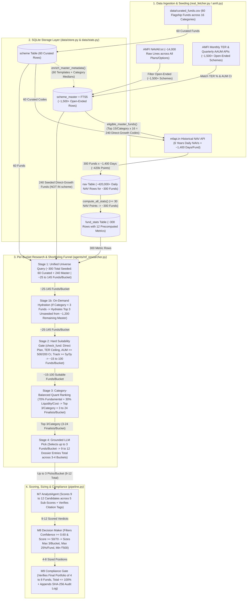
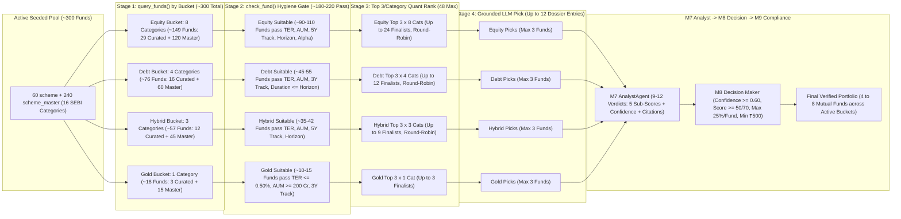

# Mutual Fund Ingestion, Storage Schema, and Shortlisting Flow

This document explains the complete end-to-end lifecycle of mutual fund data in **AI Personal Wealth Manager**—from how raw market data is fetched and stored in SQLite, to how the database tables are structured and queried, and how ~1,500+ open-ended schemes are narrowed down to a final, compliance-verified portfolio of 4–8 funds when a user clicks **Advise**.

---

## 1. End-to-End Architecture Overview



---

## 2. How Mutual Funds Are Fetched & Seeded

Data ingestion is orchestrated by [`MfapiAmfiProvider.sync()`](../src/wealth_advisor/data/real_fetcher.py) (invoked via `wealth-advisor seed-real` or the UI/API data sync endpoints). It combines **four external/local sources** so that every recommended fund has both institutional metadata (TER, AUM, category, benchmark) and 6 years of daily NAV history.

### 2.1 The Four Data Sources

| Source | Module / Function | What It Provides | Target Table(s) |
| :--- | :--- | :--- | :--- |
| **1. Hand-Curated Flagship CSV** (`data/curated_funds.csv`) | [`load_funds_csv()`](../src/wealth_advisor/data/store.py) | 60 flagship Direct-Growth funds across all 16 SEBI categories, including fields **not available in free AMFI feeds**: `manager`, `manager_since`, debt metrics (`ytm`, `modified_duration`, `avg_maturity_years`), `rating`, and `benchmark`. Also includes benchmark proxy index funds used for Alpha/Beta calculation. | `scheme` |
| **2. AMFI Daily `NAVAll.txt`** (`amfiindia.com/spages/NAVAll.txt`) | [`fetch_nav_all()`](../src/wealth_advisor/data/amfi.py), [`sync_scheme_master()`](../src/wealth_advisor/data/amfi.py), [`load_nav_all()`](../src/wealth_advisor/data/amfi.py) | Parses ~14,000 raw AMFI lines, filters to Open-Ended schemes (~1,500+ schemes), extracts AMC name, SEBI category header, plan (`direct`/`regular`), option (`growth`/`idcw`), ISINs, and latest daily NAV. | `scheme_master`, `scheme_master_fts`, `nav` |
| **3. AMFI Monthly TER & Quarterly AAUM APIs** | [`sync_latest_ter()`](../src/wealth_advisor/data/amfi_ter.py), [`sync_latest_aum()`](../src/wealth_advisor/data/amfi_aum.py) | Fetches official scheme-wise Total Expense Ratio (`expense_ratio`) and Quarterly Average AUM (`aum_cr`) from AMFI's JSON/CSV endpoints and matches them to `scheme_master` by ISIN or normalized scheme name. | `scheme_master` |
| **4. `mfapi.in` Historical NAV API** (`api.mfapi.in/mf/{code}`) | [`fetch_mfapi_json()`](../src/wealth_advisor/data/real_fetcher.py), [`parse_mfapi_payload()`](../src/wealth_advisor/data/real_fetcher.py) | Fetches 6 years of daily historical NAVs (`nav_history_years = 6.0`) concurrently (`ThreadPoolExecutor(max_workers=8)`) for all 60 curated funds **plus** the top 240 eligible `scheme_master` Direct-Growth funds (`15 per category × 16 categories`). | `nav`, `scheme` (backfills `launch_date`, `isin`, `as_of`) |

### 2.2 Why Both `scheme` (60 Funds) and `scheme_master` (~1,500+ Funds) Exist
1. **Rich Metadata Not in AMFI Feeds**: Official AMFI text/JSON feeds do not publish fund manager names, manager tenure dates (`manager_since`), or debt portfolio duration/YTM (`ytm`, `modified_duration`, `avg_maturity_years`). Those live in `scheme` (loaded from `data/curated_funds.csv`).
2. **Metadata Enrichment & Fallback Templates**: [`enrich_master_metadata()`](../src/wealth_advisor/data/amfi.py) copies exact TER/AUM from `scheme` into matching `scheme_master` rows and fills any remaining NULL `expense_ratio` or `aum_cr` in `scheme_master` using known scheme lookups (`KNOWN_SCHEME_TER_AUM`) or category-median defaults (`CATEGORY_DEFAULT_TER_AUM`).
3. **Benchmark Proxy Anchors**: [`Settings.benchmark_proxy_codes`](../src/wealth_advisor/config.py) (e.g., `120716` UTI Nifty 50 Index Fund, `147622` Motilal Oswal Nifty Midcap 150, `147623` Motilal Oswal Nifty Smallcap 250) are guaranteed to be present in `scheme`, ensuring [`compute_all_stats()`](../src/wealth_advisor/data/stats.py) always has benchmark NAV series to compute Jensen's Alpha and Beta for all ~300 seeded funds.
4. **Zero Duplication**: Whenever `scheme` and `scheme_master` are combined, SQL queries enforce `m.code NOT IN (SELECT code FROM scheme)`. The 60 curated funds and 240 `scheme_master` funds form a single deduplicated **~300-fund active advisory universe**.

### 2.3 Selecting Which `scheme_master` Funds Get Full NAV History
Fetching 6 years of daily NAVs from `mfapi.in` for all ~14,000 AMFI lines at startup would be slow and unnecessary (most are Regular plans, IDCW/dividend options, or close-ended/interval schemes). Instead, [`MetadataStore.eligible_master_funds()`](../src/wealth_advisor/data/store.py) selects the best Direct-Growth open-ended schemes per category:
- Filters to `m.plan = 'direct'`, `m.option = 'growth'`, `m.structure = 'open'`, and `m.code NOT IN (SELECT code FROM scheme)`.
- Normalizes `m.category` into one of the 16 supported SEBI categories.
- Ranks candidates within each category by:
  1. **Hygiene compliance** (`expense_ratio <= category_ceiling` and `aum_cr >= category_floor`) first,
  2. **Highest AUM** (`-aum_cr`),
  3. **Lowest Expense Ratio** (`expense_ratio`).
- Takes the top `master_per_category_limit = 15` funds per category (`15 × 16 = 240` additional Direct-Growth funds), fetches their 6-year NAV histories from `mfapi.in`, and runs [`compute_all_stats()`](../src/wealth_advisor/data/stats.py) to populate `fund_stats`.

---

## 3. SQLite Database Tables, Structure & Usages

All mutual fund metadata, historical NAV series, and precomputed return/risk metrics live in a single SQLite database (`data/wealth.db` by default), managed by [`MetadataStore`](../src/wealth_advisor/data/store.py).

### 3.1 Entity-Relationship Diagram

```mermaid
erDiagram
    scheme ||--o{ nav : "60 codes -> ~84,000 NAV rows (~1,400 days/fund)"
    scheme_master ||--o{ nav : "240 seeded codes -> ~336,000 NAV rows + ~1,260 1-day snapshots"
    scheme ||--o| fund_stats : "60 codes -> 60 precomputed stat rows"
    scheme_master ||--o| fund_stats : "240 seeded codes -> 240 precomputed stat rows"
    scheme_master ||--o| scheme_master_fts : "~1,500+ rows -> ~1,500+ FTS5 index rows"

    scheme {
        TEXT code PK "60 rows | AMFI Scheme Code (e.g. 122639)"
        TEXT isin "ISIN Growth code"
        TEXT name "Full scheme name"
        TEXT amc "Asset Management Company"
        TEXT category "16 SEBI categories"
        TEXT plan "direct (60)"
        TEXT option "growth (60)"
        TEXT bucket "equity (29) | debt (16) | hybrid (12) | gold (3)"
        REAL expense_ratio "Annual TER in %"
        REAL aum_cr "Assets Under Management in Rs Crore"
        REAL rating "Star rating (1.0 - 5.0)"
        TEXT benchmark "Benchmark index name"
        TEXT launch_date "ISO date (YYYY-MM-DD)"
        TEXT manager "Fund manager name(s)"
        TEXT source "AMFI | curated | synthetic"
        TEXT as_of "Metadata snapshot ISO date"
        TEXT manager_since "Manager start ISO date"
        REAL ytm "Debt Yield-to-Maturity (%)"
        REAL modified_duration "Debt Modified Duration (years)"
        REAL avg_maturity_years "Debt Average Maturity (years)"
    }

    scheme_master {
        TEXT code PK "~1,500+ open-ended rows (240 pre-seeded Direct-Growth)"
        TEXT isin_growth "Growth ISIN"
        TEXT isin_reinvest "IDCW Reinvest ISIN"
        TEXT name "Scheme name from NAVAll.txt"
        TEXT amc "Fund house name"
        TEXT sebi_category "Raw SEBI category from AMFI header"
        TEXT category "Normalized category (16 supported)"
        TEXT plan "direct | regular"
        TEXT option "growth | idcw"
        TEXT structure "open (~1,500+)"
        REAL latest_nav "Latest NAV from NAVAll.txt"
        TEXT nav_date "Date of latest_nav"
        REAL expense_ratio "TER % (from AMFI TER API or fallback)"
        TEXT ter_as_of "TER snapshot date"
        REAL aum_cr "Quarterly AAUM in Rs Cr"
        TEXT aum_as_of "AUM snapshot date"
        TEXT source "AMFI"
        TEXT as_of "Row sync date"
    }

    nav {
        TEXT code PK,FK "~300 full-history codes + ~1,200 snapshot codes"
        TEXT date PK "~420,000+ total rows (6 years daily history)"
        REAL nav "Net Asset Value (> 0)"
    }

    fund_stats {
        TEXT code PK,FK "~300 rows (60 scheme + 240 scheme_master)"
        TEXT as_of "Date of latest NAV point used"
        INTEGER n_points "~1,400 daily observations per 6Y fund"
        REAL cagr_3y "Trailing 3-year CAGR (%)"
        REAL cagr_5y "Trailing 5-year CAGR (%)"
        REAL roll_3y_median "Median 3-year rolling return (%)"
        REAL volatility "Annualized daily return volatility (%)"
        REAL max_drawdown "Peak-to-trough drawdown (%, negative)"
        REAL sharpe "Annualized Sharpe ratio"
        REAL sortino "Annualized Sortino ratio"
        REAL pct_roll_3y "Within-category percentile for roll_3y_median (0-100)"
        REAL pct_cagr_5y "Within-category percentile for cagr_5y (0-100)"
        REAL alpha "Jensen's Alpha vs category benchmark (%)"
        REAL beta "CAPM Beta vs category benchmark"
        REAL pct_low_vol "Within-category low-volatility percentile (0-100)"
    }
```

### 3.2 Core Mutual Fund Tables: Structure & Usages

#### 1. `scheme` (Curated Flagship Universe)
- **Model**: [`FundRecord`](../src/wealth_advisor/data/store.py)
- **Primary Key**: `code` (`TEXT`)
- **Row Count**: `60` rows in real mode (`data/curated_funds.csv`) or `60` synthetic `DEMO*` rows in demo mode.
- **Written By**:
  - [`MetadataStore.add_funds()`](../src/wealth_advisor/data/store.py) during `seed-real`, `seed-demo`, or `MfapiAmfiProvider.sync()`.
- **Read By**:
  - [`MetadataStore.query_funds()`](../src/wealth_advisor/data/store.py) — primary source for the 60 flagship funds during advisory runs.
  - [`MetadataStore.get_fund()`](../src/wealth_advisor/data/store.py) / [`MetadataStore.find_fund()`](../src/wealth_advisor/data/store.py) — direct lookup by scheme code, ISIN, or name.
  - [`enrich_master_metadata()`](../src/wealth_advisor/data/amfi.py) — propagates curated TER/AUM into `scheme_master`.

#### 2. `scheme_master` & `scheme_master_fts` (Full AMFI Open-Ended Directory)
- **Model**: [`SchemeMasterRecord`](../src/wealth_advisor/data/store.py) (converted to [`FundRecord`](../src/wealth_advisor/data/store.py) via [`MetadataStore._master_to_fund()`](../src/wealth_advisor/data/store.py) when used in advisory pipelines)
- **Primary Key**: `code` (`TEXT`)
- **Indexes**: `idx_scheme_master_name(name)`, `idx_scheme_master_category(category)`, plus virtual table `scheme_master_fts USING fts5(code, name, amc)`.
- **Row Count**: `~1,500+` open-ended schemes parsed from AMFI `NAVAll.txt` (`~240` Direct-Growth schemes pre-seeded with full 6-year NAV histories and `fund_stats`).
- **Written By**:
  - [`MetadataStore.upsert_master()`](../src/wealth_advisor/data/store.py) (preserves non-null `expense_ratio` and `aum_cr` via `COALESCE` on conflict).
  - [`amfi_ter.sync_latest_ter()`](../src/wealth_advisor/data/amfi_ter.py) and [`amfi_aum.sync_latest_aum()`](../src/wealth_advisor/data/amfi_aum.py).
  - [`enrich_master_metadata()`](../src/wealth_advisor/data/amfi.py).
- **Read By**:
  - [`MetadataStore.query_funds(include_master=True)`](../src/wealth_advisor/data/store.py) — joins `scheme_master` rows (`m.code NOT IN (SELECT code FROM scheme)`) that have metadata (`expense_ratio IS NOT NULL AND aum_cr IS NOT NULL`) and NAV/stats history into the advisory candidate pool, deriving `launch_date` from `(SELECT MIN(n.date) FROM nav n WHERE n.code = m.code)`.
  - [`MetadataStore.eligible_master_funds()`](../src/wealth_advisor/data/store.py) — selects the top Direct-Growth funds per category for `mfapi.in` seeding or on-demand hydration.
  - [`MetadataStore.search_master()`](../src/wealth_advisor/data/store.py) — powers the UI's typeahead search bar (`/funds/search`), Fund Explorer, Head-to-Head Fund Comparison (`/funds/compare`), and Portfolio X-Ray holdings lookup using SQLite FTS5 prefix matching with `LIKE` fallback.

#### 3. `nav` (Daily Historical Net Asset Values)
- **Primary Key**: Composite `(code, date)` with constraint `CHECK (nav > 0)`.
- **Row Count**: `~400,000+` rows (`~300` schemes × `~1,400` trading days over 6 years, plus single-day snapshots from `NAVAll.txt` and on-demand hydrated schemes).
- **Written By**:
  - [`MetadataStore.save_nav()`](../src/wealth_advisor/data/store.py) during `MfapiAmfiProvider.sync()` and [`on_demand.ensure_nav()`](../src/wealth_advisor/data/on_demand.py).
  - [`amfi.load_nav_all()`](../src/wealth_advisor/data/amfi.py) during daily AMFI snapshot refresh.
- **Read By**:
  - [`MetadataStore.nav_series()`](../src/wealth_advisor/data/store.py) — returns a chronological `pd.Series` indexed by `pd.DatetimeIndex` for [`compute_all_stats()`](../src/wealth_advisor/data/stats.py) and [`on_demand.build_fund_profile()`](../src/wealth_advisor/data/on_demand.py).
  - [`MetadataStore.latest_nav_date()`](../src/wealth_advisor/data/store.py) & [`MetadataStore.latest_nav_as_of()`](../src/wealth_advisor/data/store.py) — used by `advise()`, daily portfolio valuation, and point-in-time backtesting.

#### 4. `fund_stats` (Precomputed Return, Risk & Peer Percentile Metrics)
- **Model**: [`FundStats`](../src/wealth_advisor/data/store.py)
- **Primary Key**: `code` (`TEXT`)
- **Row Count**: `~300` rows (one for every scheme in `scheme` U `scheme_master` that has `>= 30` daily NAV points).
- **Written By**:
  - [`compute_all_stats()`](../src/wealth_advisor/data/stats.py) -> [`MetadataStore.save_stats()`](../src/wealth_advisor/data/store.py).
  - Computes per-fund metrics (`cagr_3y`, `cagr_5y`, `roll_3y_median`, `volatility`, `max_drawdown`, `sharpe`, `sortino`), benchmark-relative `alpha` and `beta` (using 3-year trailing window against `Settings.benchmark_proxy_codes`), and **within-category peer percentiles** (`pct_roll_3y`, `pct_cagr_5y`, `pct_low_vol` on a `0–100` scale).
- **Read By**:
  - [`MetadataStore.get_stats()`](../src/wealth_advisor/data/store.py) via [`ResearchTools.get_metrics()`](../src/wealth_advisor/agents/tools.py) — converts stats into cited [`Fact`](../src/wealth_advisor/models/core.py) objects (`[CODE:cagr_3y]`, `[CODE:pct_roll_3y]`, etc.) for the Research, Analyst, Decision, and Follow-Up Q&A agents.

### 3.3 Supporting Tables in the Same SQLite Database

| Table | Defined In | Purpose |
| :--- | :--- | :--- |
| `rag_chunks` | [`rag/index.py`](../src/wealth_advisor/rag/index.py) | Stores chunked KIM/SID scheme documents (`doc_id`, `scheme_code`, `doc_type`, `as_of`, `section`, `text`, `embedding`) for semantic/lexical retrieval via `ResearchTools.search_docs()`. |
| `profile` | [`audit/log.py`](../src/wealth_advisor/audit/log.py) | Immutable, versioned store of `UserFinancialProfile` JSON snapshots (`(profile_id, version)` PK, protected by `BEFORE UPDATE` trigger). |
| `audit_log` | [`audit/log.py`](../src/wealth_advisor/audit/log.py) | Append-only, SHA-256 hash-chained ledger (`prev_hash` -> `hash`) recording every step (`profiling`, `mf_researcher`, `analyst`, `decision_maker`, `compliance`) with prompt versions and payloads. |
| `position_snapshot` & `daily_run` | [`daily.py`](../src/wealth_advisor/daily.py) | Persists recommended portfolio weights/amounts after `advise()` and tracks the 08:00 IST daily recalibration state machine (`HOLD` / `REBALANCE` / `ESCALATE`). |
| `portfolio_holding` | [`portfolio.py`](../src/wealth_advisor/portfolio.py) | Stores user-entered or CAS-imported mutual fund holdings (`code`, `units`, `avg_cost_nav`, `invested_amount`) for Portfolio X-Ray and 5/25 drift detection. |

---

## 4. How Mutual Funds Are Shortlisted & Advised (`advise()` Flow)

When a user clicks **Advise** in the UI (`POST /advise`) or runs `wealth-advisor advise`, [`pipeline.advise()`](../src/wealth_advisor/pipeline.py) executes a 5-step pipeline that narrows the ~300-fund active universe down to the final portfolio.

### 4.1 Per-Bucket Quantitative Funnel with Exact Numbers



### Step 0: Investor Profiling & Target Asset Allocation (`M3`)
1. [`ProfilingAgent.build_profile()`](../src/wealth_advisor/agents/profiling.py) computes a deterministic risk score (`0–100`) from 5 weighted dimensions:
   - Age (`15%`), Income Stability (`20%`), Horizon (`30%`), Drawdown Tolerance (`20%`), Self-Assessed Preference (`15%`), plus an emergency-fund cap (`< 3 months` caps category at `Moderate`).
2. Maps the risk score to a `RiskCategory` (`Conservative`, `Moderate`, `Aggressive`) and an `AllocationBand`, then [`target_allocation()`](../src/wealth_advisor/domain/allocation.py) computes target weights across the 4 asset-class buckets (`Bucket.EQUITY`, `Bucket.DEBT`, `Bucket.HYBRID`, `Bucket.GOLD`).
3. [`categories_for(bucket)`](../src/wealth_advisor/domain/categories.py) maps each active bucket (where `weight > 0`) to its constituent SEBI categories (16 categories total: 8 Equity, 4 Debt, 3 Hybrid, 1 Gold).

---

### Step 1: The 3-Stage Quantitative Research Funnel + LLM Pick (`M6`)
For each active asset-class bucket, [`MFResearchAgent.run()`](../src/wealth_advisor/agents/mf_researcher.py) runs a 3-stage quantitative funnel before invoking the LLM.

#### Stage 1: Broad Category Universe Query (`~90–150` funds per bucket, `~300` total)
- Calls `tools.call("query_funds", categories=list(cfg.categories))` which executes [`MetadataStore.query_funds(include_master=True)`](../src/wealth_advisor/data/store.py).
- Returns all matching curated `scheme` rows **plus** all `scheme_master` Direct-Growth rows that have `expense_ratio`, `aum_cr`, and `fund_stats` (or `>= 30` NAV points), excluding any categories/names in `goal.excluded_categories`.
- **Stage 1b (On-Demand Hydration)**: In real-data mode, if any non-excluded SEBI category has fewer than `top_per_category` (`3`) seeded funds, [`MFResearchAgent.run()`](../src/wealth_advisor/agents/mf_researcher.py) automatically queries `store.eligible_master_funds(categories=sparse_cats, per_category_limit=3, only_unseeded=True)`, fetches their NAV histories on the fly via [`ensure_nav()`](../src/wealth_advisor/data/on_demand.py), recomputes [`compute_all_stats()`](../src/wealth_advisor/data/stats.py), and merges them into the candidate pool.
- For every candidate in `recs`, calls `get_metrics(code)` and [`facts_for_fund()`](../src/wealth_advisor/agents/tools.py) to build a structured list of [`Fact`](../src/wealth_advisor/models/core.py) objects (`expense_ratio`, `aum_cr`, `track_years`, `cagr_3y`, `cagr_5y`, `roll_3y_median`, `pct_roll_3y`, `pct_cagr_5y`, `volatility`, `max_drawdown`, `sharpe`, `sortino`, `alpha`, `beta`).

#### Stage 2: Hard Suitability Hygiene Gate
Every candidate is checked against [`guardrails/suitability.py :: check_fund()`](../src/wealth_advisor/guardrails/suitability.py). Any fund with even one violation is eliminated before ranking:
- **Plan Type**: Must be `direct` (`s.require_direct_plan = True`).
- **Category Expense Ratio Ceiling**: `expense_ratio <= s.expense_ceilings[category]` (e.g., `<= 0.50%` for Index/Liquid, `<= 1.00%` for Large Cap, `<= 1.25%` for Mid/Small Cap under Rule Set 1; tighter under Rule Set 2 / Combined).
- **Minimum AUM Floor**: `aum_cr >= 500 Cr` (`200 Cr` for categories where `small_aum_ok=True`, such as Index/ELSS/Gold ETF; `1,000 Cr` / `500 Cr` under Rule Set 2 / Combined).
- **Minimum Track Record**: `track_years >= 5.0` years for Equity/Hybrid, `>= 3.0` years for Debt/Gold (`3.0` years across buckets under Rule Set 2).
- **Minimum Investment Horizon**: `goal.horizon_years >= min_horizon(category)` (e.g., Small Cap requires `>= 7y`, Mid/Flexi Cap `>= 5y`, Large Cap `>= 3y`, Short Duration `>= 1y`, Liquid/Overnight `>= 0y`).
- **Rule Set 2 / Combined Extra Checks**:
  - Active equity funds must have **positive Jensen's Alpha** (`alpha > 0`) when `s.require_positive_alpha = True`.
  - Debt funds must have `avg_maturity_years <= goal.horizon_years` when `s.match_maturity_to_horizon = True`.

#### Stage 3: Category-Balanced Quantitative Ranking (`top_per_category = 3`)
Rather than sending 100+ funds in a single prompt (which causes LLM positional bias and context bloat), Stage 3 ranks all hygiene-passing funds **within each SEBI category** using [`_quant_rank_score()`](../src/wealth_advisor/agents/mf_researcher.py):

$$\text{QuantRankScore} = 0.70 \times \text{FundamentalScore} + 0.30 \times \text{LiquidityCostScore}$$

Where (from [`domain/subscores.py`](../src/wealth_advisor/domain/subscores.py)):
- **`fundamental_score`** (`0–100`): Weighted blend of within-category 3Y rolling return percentile (`pct_roll_3y`, `35%`), 5Y CAGR percentile (`pct_cagr_5y`, `25%`), Sharpe ratio (`25%`), and Sortino ratio (`15%`) under Rule Set 1 (or Alpha + Low-Volatility percentile + Rolling 3Y percentile under Rule Set 2 / Combined).
- **`liquidity_cost_score`** (`0–100`): 60% Expense Headroom (`(ceiling - expense_ratio) / ceiling`) + 40% log-scaled AUM depth above the category floor.

The top **3 funds per SEBI category** (`cfg.top_per_category = 3`) are selected and interleaved in **round-robin order** across categories (rank #1 of each category first, then rank #2, then rank #3). This produces a compact, high-signal table of **`~9–24` top quantitative finalists per bucket** (`3 × number of eligible categories in that bucket`).

#### Stage 4: Grounded LLM Selection (`max_picks = 3` per bucket)
- The LLM receives only the Stage 3 finalist table and selects up to `cfg.max_picks = 3` funds for that bucket (`Selection(picks=[Pick(scheme_code, reason)])`).
- **Hallucination & Grounding Guardrail**:
  - Unknown `scheme_code` values not in the candidate pool are immediately dropped.
  - Every one-sentence `reason` is verified by [`guardrails/grounding.py :: check_text()`](../src/wealth_advisor/guardrails/grounding.py) to ensure every number in the prose matches a `Fact.value` for that fund (`±0.5%` tolerance) and no unresearched fund names appear. If validation fails, the agent retries once and otherwise strips the ungrounded reason while keeping the valid `scheme_code`.
- **Funnel Telemetry**: Every bucket run records `funnel_stats = {"universe_count": ..., "suitable_count": ..., "shortlisted_count": ..., "picked_count": ...}` in `ResearchResult` and `audit_log`.

---

### Step 2: Multi-Factor Scoring & Citation-Checked Analysis (`M7`)
Across the active buckets, `MFResearchAgent` passes **`~9–12` DossierEntry items** (`up to 3 per bucket × 3–4 active buckets`) to [`AnalystAgent.analyse()`](../src/wealth_advisor/agents/analyst.py), which runs in parallel (`ThreadPoolExecutor`):
1. **Deterministic Sub-Scores (`0–100`)**:
   - `fundamental` (`35%` weight): Rolling return consistency, 5Y CAGR percentile, Sharpe, Sortino, Alpha.
   - `fit` (`25%` weight): Horizon margin above category minimum + bucket/risk-category alignment + volatility comfort.
   - `liquidity_cost` (`20%` weight): Expense ratio headroom below category ceiling + log AUM scale.
   - `news` (`10%` weight) & `sentiment` (`10%` weight): Derived from live RSS news enrichment (`data/news.py`), or `50.0` neutral when no news events are present.
2. **Conflict Detection & Confidence (`0.0–1.0`)**:
   - [`detect_conflicts()`](../src/wealth_advisor/domain/subscores.py) flags contradictions (e.g., high 5Y CAGR paired with severe drawdown `> 25%`, or high rating paired with top-quartile expense ratio).
   - [`confidence()`](../src/wealth_advisor/domain/subscores.py) starts at `1.0` and deducts penalties for missing core metrics, detected conflicts, or stale RAG document citations (`> 365` days old).
3. **Citation-Verified Pros/Cons**:
   - The LLM writes `pros`, `cons`, and `change_conditions` where every bullet **must** end with a valid `[CODE:fact_name]` citation tag (verified by `check_text(..., require_citation_ids=True)`). If rejected after 1 retry, deterministic cited bullets (`_fallback()`) are used.

---

### Step 3: Deterministic Portfolio Sizing & Action Rules (`M8`)
[`agents/decision.py :: decide()`](../src/wealth_advisor/agents/decision.py) is **100% deterministic** (no LLM calls):
1. **Hard Gate Re-check**: Re-runs `check_fund()` on every candidate; any failing fund is added to `decision.rejected`.
2. **Confidence Gate**: Any candidate with `effective_confidence < s.min_confidence` (`0.60`) is routed to `decision.escalations` for human review.
3. **Minimum Conviction Score Gate**: Candidates with `verdict.score < s.buy_min_score` (`50.0` for initial advice; `70.0` for new buys during daily recalibration) are rejected.
4. **Conviction-Weighted Position Sizing** ([`domain/sizing.py :: size_positions()`](../src/wealth_advisor/domain/sizing.py)):
   - Within each bucket, ranks qualifying funds by `verdict.score` and selects up to `s.max_instruments_per_bucket` (`3`).
   - Allocates the bucket's target weight proportionally to each fund's score (`weight_i = bucket_weight * score_i / sum(scores)`).
   - Enforces the single-fund concentration cap (`s.max_weight_per_instrument = 25%`) and minimum ticket size (`s.min_ticket = ₹500`). Any excess weight above the 25% cap is recorded as `unallocated_weight` rather than violating concentration limits.

---

### Step 4: Final Compliance Gate & Audit Persistence (`M9`)
1. [`guardrails/compliance.py :: review()`](../src/wealth_advisor/guardrails/compliance.py) calls [`verify_plan()`](../src/wealth_advisor/guardrails/suitability.py) over the entire assembled portfolio:
   - Total weight `<= 100%`.
   - Every single instrument weight `<= 25%`.
   - Every bucket has `<= 3` instruments and total bucket weight `<= AllocationBand.max`.
   - Every recommended instrument passes all `check_fund()` rules.
   - If any violation is found, `SuitabilityError` is raised, logged as `"blocked": True` in `audit_log`, and output is blocked.
2. Attaches mandatory SEBI disclosures and saves the initial portfolio snapshot via [`save_initial_position()`](../src/wealth_advisor/daily.py) so the 08:00 IST daily recalibration job can track drift and conviction changes.

---

## 5. Summary of Fund Counts Across the Pipeline

| Pipeline Stage | Approx. Fund Count | Key Function / Table | What Happens |
| :--- | :--- | :--- | :--- |
| **0. Raw AMFI Feed** | `~14,000` lines | `amfi.parse_nav_all()` | All AMFI scheme plans/options (Regular, Direct, IDCW, Growth, Close-ended, Interval). |
| **1. Open-Ended Directory** | `~1,500+` schemes | `scheme_master` + `scheme_master_fts` | All Open-Ended schemes indexed for instant UI search, Fund Explorer, and comparison. |
| **2. Seeded Active Universe** | `~300` funds | `scheme` (60) + `scheme_master` (240) | Top Direct-Growth funds across 16 SEBI categories pre-seeded with 6Y daily NAVs (`nav`) and precomputed metrics (`fund_stats`). |
| **3. Funnel Stage 1 (Per-Bucket Query + Hydration)** | `~90–150` per bucket (`~300` total) | `MetadataStore.query_funds()` + `ensure_nav()` | Retrieves all Direct-Growth funds in the bucket's SEBI categories; hydrates unseeded `scheme_master` funds if any category has `< 3` funds. |
| **4. Funnel Stage 2 (Hard Suitability Gate)** | `~50–100` per bucket | `guardrails.suitability.check_fund()` | Filters out funds failing TER ceiling, AUM floor, minimum track record, horizon, or positive alpha rules. |
| **5. Funnel Stage 3 (Quant Category Ranking)** | `~9–24` per bucket (`Top 3 / category`) | `MFResearchAgent._quant_rank_score()` | Ranks by `70% Fundamental + 30% Liquidity/Cost` within each SEBI category and interleaves top 3 per category round-robin. |
| **6. Funnel Stage 4 (Grounded LLM Pick)** | `Up to 3` per bucket (`~9–12` total) | `MFResearchAgent.run()` | LLM selects up to 3 finalists per bucket; citations and numbers are validated by `grounding.check_text()`. |
| **7. Analyst & Decision Sizing** | `4–8` funds in final plan | `AnalystAgent.analyse()` -> `decide()` -> `review()` | Scored across 5 dimensions, filtered by `confidence >= 0.60` and `score >= 50`, sized with `<= 25%` per fund cap, and verified by Compliance. |
