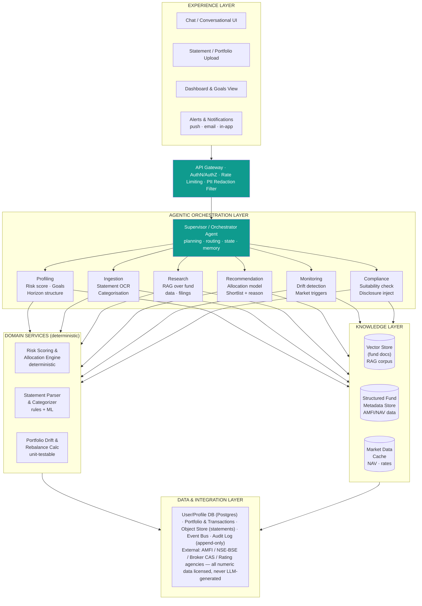
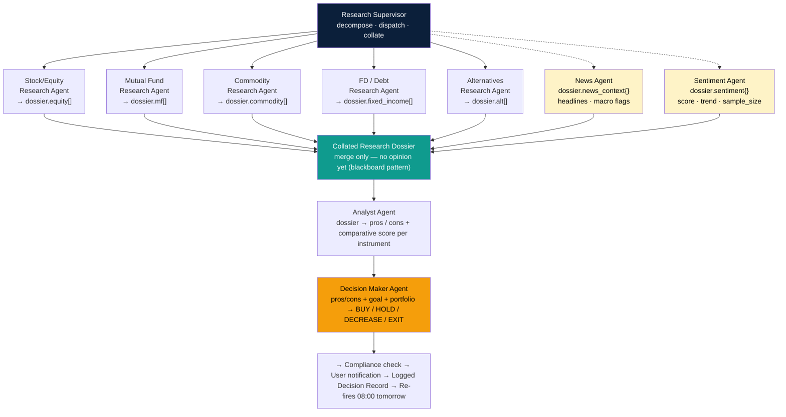
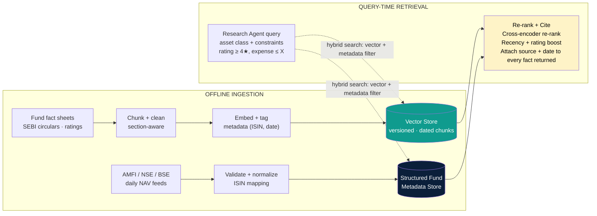
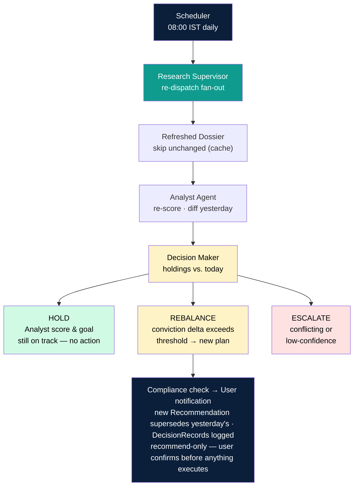
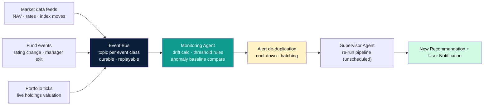

# Agentic AI System Design — Course Page Content

> Source: `course.html` (saved Educosys LMS page) + `course_files/40a369b5-c293-4549-9820-9a09deb77008.html`
> (the "Wealth Manager Agent" document loaded in the page's preview iframe).
>
> In Chrome the document is shown in a **fullscreen overlay** (with an "Exit fullscreen" button) on top of the
> LMS page. Part 1 is the LMS page underneath; Part 2 is the document shown in the overlay.

---

# Part 1 — LMS Page (Educosys dashboard, behind the overlay)

## Left sidebar

**Main**

- Dashboard
- Enrolled Courses
- Bundled Courses
- Courses
- Text Courses
- Free Courses
- Rewards
- Communities (badge: 95)

Bottom of sidebar: **Dark Mode** toggle · user menu — *ravichandar kolla* (@ravikolla)

## Main area

- Course title: **Agentic AI System Design**
- Batch selector: **Batch 2** (dropdown) · Community chat icon button
- Section heading: **Wealth Manager Agent**
- Button: **Exit fullscreen**

## Right panel — Course Content

- Community (link)
- Before You Begin
- Prerequisites
- RAG - Week 1
- Week 1 Quizzes
- RAG, Context Engineering - Week 2
- Week 2 Quizzes
- Claude Code Project - Week 3
- **Projects** *(expanded)*
  - AI Architect Agent — file
  - Fact Checker Agent — file
  - **Wealth Manager Agent — file** *(selected, checkmark)*
  - Project Progress Sheet — link
- Claude Code Project - Week 4
- Quizzes

**Invoice** card — "Download the invoice for this course." — button: *Download invoice*

---

# Part 2 — Document: "Wealth Manager Agent"

`AGENTIC AI` · `SYSTEM DESIGN` · `FINANCIAL AI` · `MULTI-AGENT`

# Building an AI Personal Wealth Advisor: A Complete Agentic System Design

How to design a multi-agent system that understands your financial goals, fans out research across five asset classes simultaneously, synthesizes evidence into grounded recommendations, and re-evaluates your portfolio every single morning — without ever hallucinating a fund name.

*Educosys · Agentic System Design*

---

Most financial advice apps are essentially calculators with a chat interface bolted on. You enter a number, they run a rule, they give you a generic allocation. There is no research. There is no reasoning. There is definitely no "checking in every morning to see if the world changed overnight."

A genuinely useful AI financial advisor needs to do something much harder: understand your specific goal, go research the actual instruments you should invest in across multiple asset classes, synthesize conflicting signals, make a defensible allocation decision — and then wake up every morning and do it again, comparing yesterday's decision against today's market reality to decide whether anything needs to change.

That is the system we are going to design in this article. It is an agentic system in the real sense — not one big prompt, but a coordinated pipeline of specialized agents, deterministic calculators, RAG-grounded research, and compliance guardrails. The kind of system that can be trusted not just because it sounds confident, but because every number it produces is traceable to a verified source.

> **THE CORE DESIGN CONSTRAINT**
>
> A hallucinated fund name or a wrong expense ratio is not a UX problem — it is a trust failure and potentially a compliance failure. **Every numeric claim in every recommendation must be traceable to a retrieved source or a deterministic calculation.** Nothing generated from the LLM's parametric memory. This single constraint shapes the entire architecture.

---

## 01 — What This System Actually Does

Before designing anything, it helps to be precise. This is an autonomous personal wealth advisor that works in three modes simultaneously: it listens to what you tell it in natural language, it reads your financial documents (bank statements, portfolio snapshots), and it watches the market every day.

In natural language mode, you say something like "I have ₹50,000 to invest and want low-risk returns over 5 years." The system understands this as a structured goal — amount, risk preference, horizon — and kicks off a full research pipeline to figure out which specific instruments make sense given your situation. It does not give you a generic "put 60% in equity" answer. It gives you named funds with expense ratios, ratings, five-year CAGRs, and a clear explanation of why these over the alternatives.

In document mode, you upload your bank statement or CDSL/NSDL portfolio snapshot. The system extracts your actual income, spending patterns, savings rate, and existing holdings — then uses that to build a far more accurate picture of your real financial situation than anything you could describe in a chat message.

In monitoring mode — and this is the part that makes it genuinely different from a one-shot recommendation engine — the system re-runs its full research pipeline at 8:00 AM every morning. It compares what it recommended yesterday against today's fresh market data. If the case for or against an instrument has materially changed, it tells you. If nothing significant has shifted, it stays quiet. The recommendation is not a static snapshot — it is a living, daily-updated position.

| **9** | **5** | **08:00** | **0** |
|---|---|---|---|
| specialized agents in the pipeline, each with a focused, bounded responsibility | asset-class researchers running in parallel on every research cycle | IST every morning — the full pipeline re-fires automatically | numeric claims allowed without a verified, retrieved citation |

Critically, the system **recommends** — it does not execute. There are no trades, no money movements, no broker API calls. This is a deliberate architectural and regulatory boundary. The system's job is to give you a fully researched, fully explained position on what your portfolio should look like. What you do with that is your call.

---

## 02 — High-Level Architecture: Five Planes

The system is organized into five logical planes. Each plane has a distinct responsibility, and the boundaries between them matter more than what is inside any single one.

**HIGH-LEVEL ARCHITECTURE — FIVE PLANES**

The key architectural principle here is that **LLM reasoning and deterministic calculation are kept in separate planes and never mixed**. Financial math — risk scoring, allocation percentages, portfolio drift calculations — all lives in the Domain Services layer as unit-tested, reproducible code. The LLM agents call these as tools. They never generate the numbers themselves. This is what makes the system auditable: six months later, you can replay exactly why it gave a specific recommendation because the inputs to the calculation are all logged.

The Knowledge layer is equally deliberate. The vector store holds research documents (fund fact sheets, SEBI circulars, rating reports). The structured metadata store holds clean, licensed fund data from AMFI and exchange feeds. The LLM agents retrieve from these — they never make up fund data from training memory. This separation between "what the LLM is allowed to say" and "what the LLM is allowed to know" is what the grounding contract is built on.

---

## 03 — The Multi-Agent Research Architecture

This is the heart of the system. The architectural shape is: **fan-out research → collate → analyze → decide → re-run daily**. Let us walk through each stage.

### The Research Supervisor and the Fan-Out

When a research cycle begins — either because a user just asked a question, or because the 8:00 AM scheduler fired — the Research Supervisor takes over. Its job is purely decomposition and dispatch. It does not do any research itself. It looks at the user's goal, risk band, and the universe of instruments to consider, then spins up one specialized Research Agent per asset class, all running in parallel.

**RESEARCH FAN-OUT ARCHITECTURE — SUPERVISOR → DOSSIER → ANALYST → DECISION MAKER**

The parallel fan-out is the single most important latency decision in this system. If the five researchers plus the two context agents ran sequentially, a single research cycle could take several minutes. Running them all simultaneously collapses the total research time to the time of the slowest single researcher — typically 30–40 seconds — not the sum of all seven. The Supervisor waits on all of them with a timeout. If one times out, it marks that section of the dossier as "no data" rather than blocking forever or silently dropping it.

### Asset-Class Specialization: Why Not One Generalist Researcher?

It is tempting to simplify by giving one research agent a large toolbox and asking it to cover all asset classes. The problem is that the decision-relevant facts for a bond are structurally different from those for a stock. A bond's case rests on credit rating, yield curve, and credit spread. A stock's case rests on valuation multiples, earnings trends, and insider activity. A mutual fund's case rests on expense ratio, star rating, fund manager tenure, and category performance. Having one agent context-switch between all of these with a shared prompt produces worse research than having a specialist who is configured — persona, tools, output schema — specifically for that asset class.

Each researcher writes its findings into its own dedicated field in a shared Research Dossier. This is the blackboard architecture pattern: a shared data structure that all specialists write into, coordinated by the Supervisor, with no agent touching another's field. No agent messaging another agent directly. Clean, coordinated, auditable.

### News and Sentiment: Why Keep Them Separate?

Two dedicated context agents run in parallel alongside the asset-class researchers. The News Agent pulls relevant headlines and macro news — rate decisions, budget announcements, regulatory circulars — for the instruments under research. The Sentiment Agent reads public mood: social sentiment, search trends, options positioning where available, fund flow direction.

They are deliberately kept as separate agents rather than folded into each researcher for two reasons. First, you avoid five redundant, slightly inconsistent news searches per cycle — there is one News Agent producing one deduplicated view of "what's happening." Second, mood and fact are different things and should be individually inspectable. If the Equity Research Agent is bullish on fundamentals but the Sentiment Agent shows sharply deteriorating public mood, that tension needs to be surfaced clearly in the Analyst's output, not pre-blended into one fuzzy signal before anyone sees the conflict.

### Collation: Merge, Not Synthesis

Once all researchers and context agents have reported (or timed out), the Supervisor performs collation. This is a merge, not a synthesis. The Supervisor validates the schema, resolves missing sections with explicit "no data" markers, and passes the unified dossier forward. It does not form any opinion about what the dossier means. That is the Analyst Agent's job — and keeping "gathering evidence" strictly separate from "forming a judgment" is what makes the system auditable at each stage.

### The Analyst Agent: Turning Evidence into Pros and Cons

The Analyst Agent ingests the entire dossier and, for each candidate instrument, produces a structured verdict: a pros list, a cons list, a comparative score, a confidence level, and the specific conditions that would change the call. The score is not a free-floated LLM number — it is computed against a fixed rubric so instruments in the same category are genuinely comparable:

| Scoring Factor | Weight | What Feeds It |
|---|---|---|
| **Fundamental / quality signal** | 35% | Category-appropriate: valuation & earnings for equity; rating & expense ratio for funds; credit rating & yield for debt; supply-demand for commodities |
| **Fit against target allocation & risk band** | 25% | How well the instrument fills a specific gap in the target allocation without breaching the user's risk band |
| **News materiality** | 20% | News Agent's tagged headlines — weighted by materiality flag, not headline count |
| **Sentiment trend** | 10% | Sentiment Agent's score and trend direction, discounted for small sample sizes |
| **Liquidity & cost** | 10% | AUM / trading volume floor, expense ratio / exit-load ceiling, FD early-withdrawal penalties |

> **CONFLICTING SIGNALS ARE SURFACED, NOT AVERAGED**
>
> If the Stock Research Agent is bullish on fundamentals but the Sentiment Agent shows deteriorating public mood and the News Agent flags a regulatory inquiry, the Analyst is required to put that tension explicitly into the cons list with both sources cited — never quietly net the signals into one smoothed-over score. For large allocations where signals actively disagree, the Decision Maker can trigger a short **bull-vs-bear debate round** between two ephemeral LLM personas before finalizing. This is invoked selectively for cost control, not on every instrument.

### The Decision Maker Agent: The Binding Call

Everything funnels into the Decision Maker — the single agent authorized to commit capital. It takes the Analyst's pros/cons and scores, the user's financial profile (risk band, horizon, goal), and the current portfolio state, and produces a per-instrument action: **BUY / INCREASE / HOLD / DECREASE / EXIT**, a target weight, and a citation-backed rationale.

This step deliberately runs on the more capable, higher-cost model tier. It is the single highest-leverage point in the pipeline — the last checkpoint before a recommendation reaches the user. The allocation algorithm within this step drops instruments that fail hard suitability filters (rating floor, cost ceiling, excluded categories), ranks survivors by Analyst score, selects a small shortlist per asset-class bucket (typically one to three instruments per bucket), and sizes each position proportionally, subject to a concentration cap. Every decision line cites the specific pros and cons that drove it.

---

## 04 — Financial Profiling & Risk Scoring

Before any research happens, the system needs to know who it is advising. The Profiling Agent builds and maintains a versioned UserFinancialProfile — versioned because every recomputation creates a new row rather than overwriting the old one. This matters for auditability: six months from now, you need to be able to replay exactly what profile produced a given recommendation.

The risk score itself is computed by a deterministic `compute_risk_score` tool — not generated by the LLM. The distinction is fundamental. A risk score that changes every time you prompt the model is not useful. A risk score derived from a fixed, weighted formula applied to structured inputs is reproducible, testable, and explainable.

| Risk Factor | Weight | Signal Source |
|---|---|---|
| **Investment horizon** | 30% | Stated goal date or explicit horizon from chat or document |
| **Stated risk preference** | 25% | NLU extraction from chat, confirmed back to user against a fixed taxonomy |
| **Savings rate & income stability** | 20% | Derived from statement analysis — surplus buffer available for loss absorption |
| **Existing allocation / diversification** | 15% | Portfolio snapshot if provided |
| **Liquidity needs / emergency fund** | 10% | Expense coverage ratio from statement analysis |

The output is a 1–10 score mapped to a category (Conservative / Moderate / Aggressive), each bound to an allocation band. Conservative maps to 70–85% debt/hybrid and 15–30% equity. Aggressive inverts that. These bands are what the Research Supervisor uses to decide which asset-class researchers are even worth dispatching for this user's goal — a user with a conservative profile in a six-month horizon barely needs an equity researcher at all.

The document upload flow feeds directly into this profile. When a user uploads a bank statement, the Ingestion Agent extracts individual transactions using layout-aware OCR tuned for Indian bank statement formats and CDSL/NSDL portfolio exports. A rules-plus-ML categorizer classifies each transaction (salary, EMI, rent, SIP debit, discretionary spend). Anything below the confidence threshold gets queued for user confirmation rather than silently guessed — because a misclassified SIP debit is not just a UX problem, it corrupts the savings rate calculation that feeds the risk score that drives the whole recommendation.

---

## 05 — The RAG Pipeline: Grounded Research at Query Time

Research-backed recommendations are only as good as the research pipeline. The system uses a two-part knowledge architecture: an offline ingestion pipeline that builds and maintains the research corpus, and a query-time retrieval pipeline that the Research Agents use during every cycle.

**RAG PIPELINE — OFFLINE INGESTION + QUERY-TIME RETRIEVAL**

The grounding contract is the critical piece. Research Agents are prompted — and post-validated — to only state facts present in retrieved chunks, with an inline citation per claim. A validator step rejects any numeric claim lacking a citation before it reaches the Analyst Agent. This is the core hallucination-mitigation mechanism. It is not "trust the LLM to be accurate." It is "the LLM cannot make a factual claim without showing its work."

Hybrid retrieval matters more here than in most RAG applications because the constraints are partly semantic and partly numeric. Vector similarity handles the semantic matching — "find research relevant to moderate-risk debt instruments for a 5-year horizon." Structured metadata filters handle the numeric constraints — "expense ratio ≤ 0.8%, rating ≥ 4 stars, AUM ≥ ₹500 Cr." These need to be enforced exactly, not approximately. A 0.9% expense ratio fund does not become acceptable because it is semantically similar to a 0.6% fund.

---

## 06 — The Daily Recalibration Cycle

This is what transforms the system from a one-shot recommendation tool into something genuinely useful over time. The entire fan-out research pipeline fires automatically every morning at 8:00 AM IST — ahead of Indian market open — so the recommendation for the day is ready before trading begins.

**DAILY 08:00 IST RECALIBRATION CYCLE — HOLD / REBALANCE / ESCALATE**

*Anti-overtrading: REBALANCE fires only when conviction delta ≥ configured minimum — daily noise is absorbed*

The daily cycle reuses the exact same pipeline described above — there is no separate "monitoring logic" duplicating the research code. The key addition is that the Decision Maker also receives the previous cycle's recommendation and the portfolio's actual current holdings, so it is explicitly comparing "what we hold" against "what today's fresh research says we should hold." The output of each day's cycle is one of three decisions:

- **HOLD:** The Analyst score and goal trajectory are still on track. No material change in the case for the current holdings. Nothing sent to the user — a quiet day is itself a logged, auditable fact ("we checked and nothing changed").
- **REBALANCE:** The conviction delta — the change in Analyst score plus the strength of supporting evidence — exceeds the configured threshold. A new recommendation is generated, runs through compliance, and is sent to the user.
- **ESCALATE:** Conflicting signals or low confidence. The Decision Maker does not commit to a recommendation. The case is routed to a human reviewer before anything reaches the user.

The anti-overtrading mechanism deserves emphasis. Without it, daily re-scoring would occasionally nudge a score across a naive threshold purely on noise — generating a REBALANCE recommendation that costs the user exit loads and short-term capital gains for no real reason. The conviction delta threshold, combined with portfolio drift bands, means small day-to-day fluctuations are absorbed. REBALANCE is the exception, not the daily norm.

### Intra-Day Event Triggers

Between two 8:00 AM cycles, some events cannot wait until the next morning. A fund rating downgrade, a fund manager change, or a sharp index move that pushes the portfolio meaningfully outside its drift band — these warrant an out-of-cycle evaluation. A lightweight, always-on Monitoring Agent watches a durable event bus fed by market data and fund event feeds. When a threshold is crossed, it triggers the Supervisor for an unscheduled cycle rather than waiting until tomorrow.

**EVENT-DRIVEN MONITORING — INTRA-DAY SHOCK RESPONSE**

---

## 07 — Compliance, Guardrails & Regulatory Posture

Automated investment guidance in India sits under SEBI's Investment Adviser Regulations, 2013 (as amended through November 2025). The core principle the regulations establish is important: using AI does not reduce a provider's responsibility — it increases it. Algorithm testing, human oversight, disclosure of AI involvement, and conflict-of-interest management are all expected. If this system is not operated by a SEBI-registered Investment Adviser, recommendations must be framed as educational and informational, not personalized investment advice, with prominent disclosure.

The system implements compliance as defense in depth — multiple independent layers, each of which would catch a problem the previous layer might have missed:

| Guardrail Layer | Mechanism |
|---|---|
| **Input validation** | Reject queries asking for out-of-scope actions (leverage, derivatives, trade execution) before they reach the LLM. |
| **Retrieval grounding** | All numeric claims must trace to a cited, retrieved source. This is the primary hallucination defense. |
| **Post-generation validator** | Automated check that every fund name and number in the output matches something retrieved this turn. Unmatched claims are stripped and the response regenerated. |
| **Suitability rule engine** | Deterministic checks: does the shortlist violate the user's stated constraints (risk category, excluded categories, liquidity needs)? Blocks non-compliant output rather than warning after the fact. |
| **Disclosure injection** | Every recommendation response carries a standard disclosure: AI-generated, educational in nature, past performance ≠ future results, link to full risk disclosures. |
| **Human-in-the-loop escalation** | Low-confidence extractions, high-value goals, and first-time large allocations route to optional human adviser review before being finalized. |
| **Audit trail** | Append-only log of every agent decision, tool call, model/prompt version, and data used. Required for inspection readiness and for explaining "why did it recommend X" months later. |

> **THE HALLUCINATION GUARDRAIL IS DOUBLE-LAYERED**
>
> The Analyst and Decision Maker agents are never permitted to output a fund name, price, rating, or return figure that did not arrive via a tool call with a citation in the current cycle's dossier. This is enforced by a **post-generation validator** (entity extraction cross-checked against the citation set) before the Compliance Agent even sees the output. This is a second, independent layer of hallucination defense, on top of the retrieval grounding described earlier. Two separate systems must both fail before a hallucinated number reaches a user.

---

## 08 — Key Design Patterns Worth Naming

This system is a good example of several reusable agentic architecture patterns. Understanding them by name makes it easier to recognize where they apply in other domains.

| Pattern | Where It Appears | Why It's Useful |
|---|---|---|
| **Supervisor fan-out / fan-in** | Research Supervisor dispatching 5 researchers + News + Sentiment in parallel, then collating | Bounds latency by the slowest branch, not the sum of all branches |
| **Blackboard / shared state** | The Research Dossier every specialist writes its own field into | Coordinates specialists without peer-to-peer messaging; keeps merge (dumb) separate from synthesis (smart) |
| **Agent factory** | One researcher template stamped out per asset class | A new asset class is new config (persona + toolset + output field), not new code |
| **Evidence / judgment separation** | Analyst Agent (pros/cons) as a distinct step from Decision Maker (binding call) | Keeps balanced analysis auditable independently of the allocation decision |
| **Hierarchical judge** | Analyst normalizes → Decision Maker arbitrates → Compliance gates | Escalating authority and model cost only at points where it's worth it |
| **Selective adversarial debate** | Optional bull/bear round only for conflicting-signal instruments | Gets bias-correcting benefit of structured disagreement without paying for it on every instrument |
| **Scheduled re-planning loop** | Daily 08:00 re-run, diffed against yesterday | Turns a one-shot recommendation into a system that keeps tracking a moving goal against a moving market |
| **Conviction-delta thresholding** | Decision Maker only proposes REBALANCE when score change exceeds a minimum | Stops daily re-scoring noise from causing needless churn |

### Key Trade-offs

| ✓ Asset-Class Specialist Researchers | ✗ Trade-offs |
|---|---|
| Purpose-built toolset per asset class | More agents to maintain vs. one generalist |
| Comparable structured output across runs | Higher cost per cycle (7 agents vs. 1) |
| New asset class = new config, not new code | Supervisor complexity increases with N agents |

| ✓ Deterministic Math as Tool Calls | ✗ Trade-offs |
|---|---|
| Risk scores are reproducible and testable | More engineering effort than letting LLM compute |
| Auditability for regulatory review | Formulas must be explicitly maintained |
| No LLM variance on financial numbers | Edge cases need deliberate handling in code |

| ✓ Daily Schedule + Event-Driven Hybrid | ✗ Trade-offs |
|---|---|
| Predictable freshness for most users | Two trigger systems to maintain and monitor |
| Shock responsiveness for intra-day events | Event bus adds operational complexity |
| Cost controlled by conviction-delta threshold | Alert de-duplication logic needs tuning |

---

## 09 — Roadmap: MVP to V3

| MVP → | V2 → | V3 |
|---|---|---|
| **Text query + MF research** | **Full document ingestion + all asset classes** | **Live sync + tax-aware optimization** |
| Natural-language intake, deterministic risk scoring, RAG-grounded mutual fund shortlist, manual portfolio CSV upload, static disclosures | Bank statement OCR, auto profile updates, ETF/gold/hybrid coverage, event-driven drift monitoring, multi-turn "what if" refinement, human review queue | Broker/CAS live sync, tax-aware rebalancing, multi-goal portfolio-wide optimization, personalized retrieval ranking from outcome feedback, SEBI IA integration path |

### Closing Thoughts

The most important architectural insight in this system is not any single clever pattern — it is the consistent application of one principle across every decision: **keep LLM reasoning and deterministic calculation in separate, explicit, auditable layers.**

Financial advice is a domain where being right is not enough. You have to be provably right, explainably right, and reproducibly right. A system that gets the correct answer 95% of the time from an opaque LLM inference is not acceptable when the 5% failures involve someone's retirement savings. A system where every recommendation traces to a citation, every risk score traces to a formula, every decision traces to a logged chain of agent outputs — that is a system that can actually be trusted.

The daily recalibration cycle is the other insight worth taking away. Most recommendation systems are built as queries — you ask, you get an answer, it sits there. A wealth advisor that gives you a recommendation in January and never updates it is not a wealth advisor, it is a brochure. The design of a pipeline that continuously compares "what the research says today" against "what is in the portfolio today," filters out noise via conviction-delta thresholding, and only interrupts the user when something actually needs to change — that is what turns a chatbot into a system that genuinely works over time.
