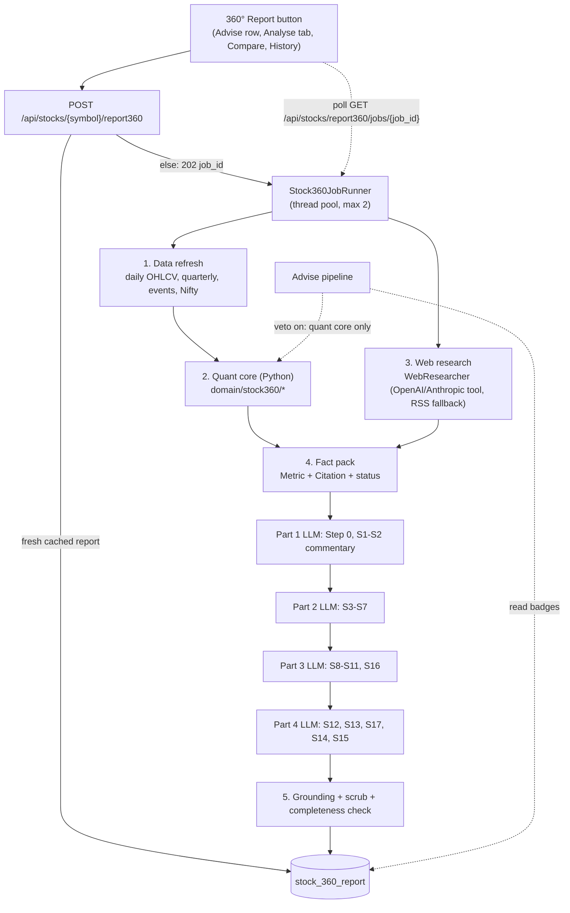

# Plan: 360° Stock Analysis for Every Recommended Stock

Source template: [360-analysis-template.md](360-analysis-template.md) (the same text as the "THE MASTER PROMPT (Full 360° Analysis) - v2" PDF).
Related plan: [stock-fundamental-analysis-plan.md](stock-fundamental-analysis-plan.md) (stock data layer, sync, Set 1/Set 2, Analyse/Compare tabs).

## Goal

Every stock the app shows as a recommendation or candidate gets a **"360° Report" button**. Clicking it produces the full Master Prompt analysis for that stock: Step 0 (data freshness audit) plus all 17 sections, generated in the template's 4 parts.

Places where stocks appear:
- Advise → "Include stocks" (screened sleeve)
- Advise → AI-notes spec (`stock_count` / `trendy_stock_count`), including **web trend picks**, which today are not fundamentally screened
- Analyse Stock tab
- Compare Stocks tab
- Advice History (reopened runs)

The report is:
- **Hybrid.** Python computes every number it can (valuation, intrinsic value, forensics, technicals, checklists, targets). The LLM writes only the judgement sections, and only from cited facts.
- **Honest about gaps.** Anything that can't be fetched or computed is shown as **"Not available"** or **"Requires live verification"** and is never guessed. This follows the template's zero-training-memory rule and the app's grounding guardrail.
- **Informational by default.** An optional setting (off by default) lets a bad 360° verdict remove a stock from the Advise plan.

---

## Options presented and selections made

| # | Question | Options | Selected |
|---|---|---|---|
| 1 | When is the report generated? | (a) Inline snapshot for every stock + full report in the background · (b) Full report automatically in the background · (c) **On demand: a "360° Report" button on each stock** | **(c) On demand** (cheapest) |
| 2 | Data the app can't get from Yahoo (shareholding/FII/DII, concall/order book, analyst consensus, governance news) | (a) **LLM web-search tool (OpenAI `web_search` / Anthropic `web_search`) that must cite URL + date for every number; Google News RSS fallback; manual overrides; else "Not available"** · (b) No web search · (c) Scrape Screener/Trendlyne | **(a)** |
| 3 | How much does the LLM write? | (a) **4 parts as in the template, one structured LLM call per part; numeric tables from Python, LLM writes judgement sections** · (b) All 17 sections narrated separately · (c) Tables + one short summary | **(a)** |
| 4 | Does the verdict change the recommendation? | (a) **Informational by default; optional setting (off) drops stocks rated AVOID/SELL or with ≥ 5/7 legend sell signals and returns their weight to mutual funds** · (b) Always drop · (c) Purely informational | **(a)** |
| 5 | Output formats | (a) **In-app structured report (drawer + tab in Analyse Stock)** · (b) Markdown download · (c) PDF export | **(a) only** |

### How "on demand" fits with verdict badges and the optional veto (decided by me)

Decision 1 (on demand) and decision 4 (badges + optional veto) could conflict, because without a report there is no verdict. They are resolved like this:

1. **Badges come from the cache.** If a fresh 360° report for the symbol already exists (same data mode, younger than `stock360_report_ttl_hours`, default 24h), the Advise row shows its rating and verdict badge. If not, the row shows only the **"360° Report"** button. Advise never generates a report by itself.
2. **The veto uses only the deterministic quant core.** When `stock360_veto_enabled = true`, Advise runs the **Python quant core only** (no LLM, no web search, a few milliseconds per stock) on each stock candidate. It drops a stock if:
   - the mechanical verdict is AVOID/SELL, or
   - at least `stock360_veto_min_sell_signals` (default 5) of the 7 legends' **mechanical** sell rules fire.

   The dropped weight goes back to mutual funds through the existing "unused sleeve → MF" path. Each drop is logged in the research log and in `stock_warnings`, with the reason.
3. **A full report always overrides.** If a fresh full report exists, its final verdict is used for the veto instead of the mechanical one.

This keeps Advise fast and deterministic (replayable), and gives the veto a basis even when nobody has clicked the button yet.

### Defaults chosen by me (adjustable in `config.py`)

| Setting | Default | Why |
|---|---|---|
| `stock360_wacc` | 0.12 | Template: 12% discount rate for India |
| `stock360_terminal_growth` | 0.045 (DCF range 0.045–0.05) | Template |
| `stock360_buffett_hurdle` | 0.12 | Template: (1.12)^5 |
| `stock360_buffett_exit_pe_cap` | 18–20 or 10Y sector median P/E, whichever is lower | Template |
| `stock360_graham_multiplier` | 22.5 | Template |
| `stock360_lynch_peg_bands` | <1.0 / 1.0–1.5 / 1.5–2.0 / >2.0 | Template |
| `stock360_consensus_rule` | SELL 5–7 · REDUCE 3–4 · HOLD 1–2 · ADD 0 | Template |
| `stock360_cash_conversion_flag` | 0.70 | Template: 3Y CFO ÷ 3Y EBITDA < 70% |
| `tax_equity_stcg_pct` / `tax_equity_ltcg_pct` / `tax_ltcg_exemption_inr` | 20 / 12.5 / 125000, with an `as_of` date | Template; editable when tax law changes |
| `stock360_report_ttl_hours` | 24 | Prices go stale after a day |
| `stock360_max_llm_calls` | 8 | 4 parts + up to 4 retries/fallbacks; separate from `max_llm_calls_per_run=12` |
| `stock360_max_web_searches` | 14 | Step 0's 5 searches + about 9 topical searches |
| `stock360_max_parallel_jobs` | 2 | Avoids rate limits |
| `stock360_veto_enabled` | false | Decision 4 |
| `stock360_veto_min_sell_signals` | 5 | Decision 4 |
| `stock360_web_search_provider` | `auto` (follows `llm_provider`); `none` turns web search off | Decision 2 |

---

## What exists today

### Where stocks reach the user

| Path | Code | Notes |
|---|---|---|
| Advise, "Include stocks" (screened) | [pipeline.py](../../src/wealth_advisor/pipeline.py) ~L340-368 → `StockResearcherAgent.run()` in [stock_researcher.py](../../src/wealth_advisor/agents/stock_researcher.py) | Reads only the synced SQLite cache; ranks by score, at most 2 per sector; category `"Direct Equity"`. |
| Advise with AI-notes spec | [pipeline.py](../../src/wealth_advisor/pipeline.py) ~L314-339 → `select_stocks()` in [web_stock_picker.py](../../src/wealth_advisor/agents/web_stock_picker.py) | Web trend picks come from `data/trend_view.json` (Google News RSS + LLM, confidence 0.7, **not fundamentally screened**); the rest are filled from the screened list. |
| Advise response rows | [main.py](../../src/wealth_advisor/api/main.py) ~L566-580, `AdviseResponse` L178 | Stock rows carry `instrument_type="stock"`, `symbol`, `market_cap_cr`, `checks_passed`. |
| Analyse Stock | `POST /api/stocks/analyze` (L2398), `GET /api/stocks/analyze/{symbol}` (L2463) | `build_single_stock_analysis()` in [stock_context.py](../../src/wealth_advisor/domain/stock_context.py) L349; `StockNarratorAgent.narrate_single_stock()` writes a 4-paragraph memo. Synchronous; audit + Langfuse. |
| Compare Stocks | `POST /api/stocks/compare` (L2493) | `compare_stocks()` + `narrate_comparison()` |
| Follow-up chat / monitoring | [followup.py](../../src/wealth_advisor/agents/followup.py), [monitoring.py](../../src/wealth_advisor/agents/monitoring.py) | Fund-only; no stock logic (confirmed by grep). Not changed by this plan. |
| Frontend Advise table | [App.tsx](../../frontend/src/App.tsx) ~L1531-1604 | `isStock` row: name → `openAnalyzeStock(code)` (L511), "STOCK" badge, `Checks: x/y`, `valuation_status` badge. |
| Frontend views | [App.tsx](../../frontend/src/App.tsx) L170 `AppView`, `switchView()` L192 | [StockAnalyzer.tsx](../../frontend/src/components/StockAnalyzer.tsx) (794 lines) uses collapsible sections. |

### Data and building blocks

- **Models** ([provider.py](../../src/wealth_advisor/data/stocks/provider.py)): `StockSnapshot` (price, market cap, EV, P/E, P/B, P/S, EV/EBITDA, ROE/ROA/ROCE, D/E, current ratio, interest coverage, dividend yield, EPS TTM, BVPS, promoter %, pledge %, beta, 1Y return/volatility/drawdown), `StockFinancialYear` (annual P&L, balance sheet, cash flow, bank metrics; `period_type="quarterly"` exists but is never filled), `StockPricePoint` (close + volume), `StockSectorMedian`.
- **Yahoo provider** ([yfinance_provider.py](../../src/wealth_advisor/data/stocks/yfinance_provider.py)): chart API with `range=5y&interval=1wk` (weekly closes only) and the annual fundamentals timeseries (~4 years). **No quarterly data, no daily OHLC, no corporate-action events, no FII/DII, no analyst targets.**
- **Domain:** `stock_ratios.py` (ratios, CAGR), `stock_rulesets.py` (Set 1/Set 2), `stock_valuation.py` (relative valuation 0.3/0.3/0.3/0.1, range 1.0–1.2×), `stock_context.py` (EIC + macro snapshot), `momentum.py` (3/6/12M returns, above 200-DMA).
- **News:** `data/news.py` (Google News RSS with sentiment/materiality, fund-centric scopes); `_fetch_one()` RSS helper in `data/trend_view.py`.
- **LLM:** `LLMClient.complete(messages, schema)` with structured output, `BudgetedLLM`, `CachedLLM`, `trace_context()`. Provider OpenAI (default, `use_responses_api=False`) or Anthropic via LangChain. **No web-search tool.**
- **Guardrails:** `scrub()` (bans guaranteed/risk-free/assured/multibagger/sure-shot), `STOCK_DISCLOSURE`, `check_text(text, facts, known_names)` — numbers must match a fact value.
- **Jobs:** the stock sync is actually synchronous behind `_SYNC_LOCK`; there is no real background job runner yet.
- **History:** `advice_history` + `followup_message` tables; no per-stock report table.
- **Frontend deps:** React 19, recharts, react-query, zustand, lucide. No Markdown renderer (not needed: the report is rendered from structured JSON).

---

## Template → data source map

Legend for **Source**: **Y** = Yahoo (existing or extended provider) · **D** = derived in Python from Y · **P** = sector peers in the synced cache · **W** = web-search evidence (URL + date) · **M** = manual override · **L** = LLM judgement over cited facts.
"Fallback" is what is shown when the source has nothing.

| Section | Items | Source | Fallback |
|---|---|---|---|
| Step 0 Freshness audit | As-of date + source + verified flag per data category | D (from every metric's citation) | Row shows "Not available" |
| Rules: corporate action / demerger | Splits, bonuses (Yahoo `events=split,div`); discontinuity check in shares/revenue; demerger news | Y, D, W | "No corporate action found in sources checked" |
| Rules: sector adapter | BFSI → NIM, GNPA/NNPA, credit cost, CASA, PCR, cost-to-income, ROA, P/ABV instead of EBITDA, current ratio, D/E, FCF | Y (bank fields), M, W | Bank metric "Not available" |
| Rules: cyclicality | Cyclical flag (existing sector map) + margin vs own 4–5Y range → Peak / Mid / Trough | D | "Insufficient history" |
| 1 Market data | CMP, 52W H/L, % from H/L, market cap, EV, sector/industry | Y, D | — |
| 1 | Index / F&O membership | W | Not available |
| 1 | Shareholding (latest + 3Q trend), pledge | W, M (promoter %/pledge from Y if present) | Not available |
| 1 | Delivery volume % | W | Requires live verification |
| 1 | Returns 1W/1M/3M/6M/1Y/3Y, relative strength vs Nifty 50 | D (daily prices + `^NSEI`) | — |
| 2A Income statement | Revenue, EBITDA/OPM, PAT, EPS: 3 FY + TTM + latest 4 quarters; 3Y CAGR, YoY, QoQ | Y (annual + **new quarterly**), D | Quarterly rows "Not available" |
| 2A | Forensic: other income % of PBT | D | — |
| 2B Balance sheet | Debt, cash, net debt, D/E, net debt/EBITDA, BVPS, current/quick ratio, CCC (receivable/inventory/payable days) | Y, D | — |
| 2B | Goodwill/intangibles, contingent liabilities % net worth | W, M | Not available |
| 2C Cash flow | CFO, FCF, capex (3Y), FCF yield, cash conversion = 3Y CFO ÷ 3Y EBITDA (flag < 70%) | Y, D | — |
| 2D Returns | ROE, ROCE, ROIC, ROA, asset turnover (trend + TTM) | D | — |
| 2E Visibility | Order book, book-to-bill, volumes, market share, ASP, utilisation (sector-adaptive) | W, M | Not available |
| 3 Valuation | P/E (TTM, 1Y fwd, 2Y fwd), P/B, EV/EBITDA, P/S, PEG, dividend yield, FCF yield | D; forward EPS from W (consensus) or D (own projection, labelled) | Forward "Not available" |
| 3 | vs own 3Y/5Y median | D (multiples at each FY end = price at FY end ÷ that year's EPS/BV/etc.) | Labelled with years available |
| 3 | vs sector average and top 3 peers side by side | P | "Insufficient peers" |
| 3 | Overvaluation verdict, % from composite IV, margin of safety | D | — |
| 4 Intrinsic value | Reverse DCF implied 10Y growth; DCF (5Y FCF, 12%, 4.5–5%) + exit-multiple cross-check; Lynch PEG 1.0/1.5/2.0; Graham Number + appropriateness note | D (+ L for appropriateness note) | Method "Not applicable" (e.g. negative EPS) |
| 5 Price vs fundamentals | 3Y price %, revenue %, PAT %, EPS %, P/E change; return decomposition (EPS growth vs re-rating %); mean-reversion price | D | — |
| 6 Moat | 5 moat types scored 1–10 with evidence; width, durability, threat | L over D + W facts | Score withheld when no evidence |
| 7 Management | Guidance adherence, capital allocation, promoter trend, pay vs PAT, RPTs, transparency; rating; red flags | L over D + W + M | "Not assessed: no evidence" per item |
| 8 Growth | TAM, industry CAGR, tailwinds/headwinds, drivers | W, L | Not available |
| 8C | FY+1..FY+3 revenue, EBITDA %, PAT, EPS with explicit assumptions | D (base: historical CAGR, capped) + optional consensus from W | — |
| 9 Risk | Business, financial, regulatory, market risks H/M/L; overall 1–10 | D (interest cover, D/E, beta, concentration where known) + L | — |
| 10 Technicals | 20/50/100/200 EMA & DMA, above/below, golden/death cross, Weinstein stage, S1–S3/R1–R3, demand/supply zones, RSI14, MACD, ADX14, volume up/down days, verdicts | D (**new daily OHLCV**) | Chart patterns + delivery % → "Requires Live Chart Verification" |
| 11 Sentiment | Latest 5–10 news with dates | W, RSS | — |
| 11 | Analyst Buy/Hold/Sell, targets, earnings surprise, EPS revisions, FII/DII QoQ, bulk/block deals, social sentiment | W | Not available |
| 12 Buffett | Checklist (mechanical items D, judgement items L); entry price = 5Y fwd EPS × exit P/E ÷ 1.12⁵; stretch price; % discount needed; YES/NO/MAYBE; probability; simulated quote | D + L | — |
| 13 Lynch | Category (6 types), PEG verdict, entries at PEG 1.0/1.5/2.0, two-minute drill, metrics to watch | D (category from growth rates + cyclical flag) + L | — |
| 14 Targets | 1/3/6/9-month bear/base/bull (technical levels + ATR-based ranges) | D | — |
| 14B | 1/2/3/5Y targets = projected EPS × bear/base/bull multiple | D | — |
| 14C | Tranche entry zone, stop loss (technical + thesis trigger), R:R, position size | D (sizing capped by `max_weight_per_stock`) + L for the thesis trigger | — |
| 15 Verdict | Stars X/5, suitability per investor type, one paragraph, bull/bear top 3, monitor list, final action | D (mechanical score) + L (text) | — |
| 16 Market cycle | Phase 1–4 + sub-stage from shareholding shifts, valuation band vs history, price structure | D + W + L | Phase marked "Low confidence" when shareholding is missing |
| 17 Legends' sell analysis | 7 legends × documented triggers, verdict, conviction, consensus score, top-5 sell / not-sell, phased exit, tax, re-entry | D (mechanical triggers, see next table) + L | Trigger "Not evaluable" |

### Section 17: which sell triggers are mechanical

**D** = computed in Python (used by the optional veto) · **J** = LLM judgement over cited facts · **W** = needs web evidence; "Not evaluable" when there is none.

| Legend | Trigger | Type | Mechanical rule |
|---|---|---|---|
| Buffett | Moat deteriorated / thesis wrong / management untrustworthy / better opportunity | J | — |
| Buffett | Industry economics worsened | D + J | ROCE below its 4Y median for 2 years in a row |
| Buffett | Valuation absurdly above intrinsic value | D | CMP > 1.5 × composite intrinsic value |
| Lynch | PEG > 2.0 (cyclicals: margins at peak + low P/E) | D | PEG > 2.0, or cyclical AND cycle = Peak |
| Lynch | Fundamentals deteriorating | D | OPM down 2 periods AND (receivable days or D/E) up |
| Lynch | Overcrowded / hype / diworsification / insiders selling | W + J | — |
| Graham | At or above Graham Number; ≥ 50% premium | D | CMP ≥ Graham Number; CMP ≥ 1.5 × Graham Number |
| Graham | Earnings/margins down 2 periods | D | PAT or OPM down 2 consecutive years (or quarters when available) |
| Graham | D/E > 1.0; current ratio < 1.5 | D | Non-banks only |
| Graham | Margin of safety gone | D | CMP > composite intrinsic value |
| Fisher | Mistake / deterioration / far better opportunity | J | Fisher's "do not sell on high P/E alone" is enforced in the prompt |
| Munger | Pricing power down / incentives misaligned / moat eroding / opportunity cost; inversion test | J | Pricing-power proxy (D): gross or OPM down 3 years |
| Livermore | No new highs on volume (churning); distribution; pivot broken; extended; RS divergence | D | Price < 50-DMA with down-volume > up-volume (20d); close below last swing low (pivot); > 40% above 200-DMA; 3M RS vs Nifty < 0 while the sector median is > 0 |
| Livermore | Broad market bear phase | D | Nifty 50 below its 200-DMA |
| RJ | Macro story weakened / execution broke / governance | W + J | — |
| RJ | Valuation > 3 years ahead of earnings | D | CMP > value at (projected EPS in 3 years × 5Y median P/E) |
| RJ | ROCE/ROE no longer compounding > 18–20% | D | Latest ROCE (non-bank) or ROE (bank) < 18% |
| RJ | Crowded retail trade | W | Public % up AND FII+DII % down QoQ (when shareholding is known) |

The **mechanical legend verdict** for one legend = SELL when ≥ 2 of its D triggers fire, REDUCE when 1 fires, otherwise HOLD; legends with no D triggers are counted as "not evaluable" in mechanical mode (not as HOLD). The veto counts SELL/REDUCE legends among the evaluable ones.

---

## Architecture



### Core data structures (in `domain/stock360/models.py`)

```python
MetricStatus = Literal["verified", "computed", "estimated", "manual", "unavailable", "requires_live_verification", "not_applicable"]

class Metric(BaseModel):
    id: str                      # fact id, e.g. "TCS:s3:pe_ttm" — citable as [TCS:s3:pe_ttm]
    label: str
    value: float | str | None
    unit: str = ""               # "₹", "₹ Cr", "%", "x", "days"
    status: MetricStatus
    as_of: date | None
    source: str                  # "yahoo_chart", "yahoo_timeseries", "derived", "peers", "web:<domain>", "manual"
    url: str = ""
    formula: str = ""            # for computed metrics, shown on hover
    inputs: list[str] = []       # ids of the metrics used

class SectionTable(BaseModel):
    title: str
    columns: list[str]
    rows: list[list[str | float | None]]
    metric_ids: list[str] = []

class Section(BaseModel):
    id: str                      # "step0", "s1" ... "s17"
    title: str
    part: Literal[1, 2, 3, 4]
    metrics: list[Metric] = []
    tables: list[SectionTable] = []
    commentary: str = ""         # LLM text with [fact_id] citations
    verdict: str | None = None   # section-level label (e.g. "Overvalued", "Stage 2")
    status: Literal["complete", "partial", "unavailable"]
    missing: list[str] = []      # items the template asks for that we could not get

class Report360(BaseModel):
    report_id: str
    symbol: str
    name: str
    data_mode: Literal["synthetic", "real"]
    template_version: str = "master-v2"
    generated_at: datetime
    as_of: date
    sector_adapter: Literal["general", "bfsi", "cyclical"]
    sections: list[Section]      # step0 + s1..s17, always all 18 present
    mechanical: MechanicalVerdict   # quant-only rating, legend triggers, consensus score
    final: FinalVerdict | None   # LLM-written verdict (None in mechanical-only mode)
    sources: list[WebSource]     # every URL used, with title, publisher, published_at, fetched_at
    llm_calls: int
    web_searches: int
    warnings: list[str]
    disclosures: list[str]
```

`Metric` facts are converted to the existing `Fact`/`Citation` models so `check_text()` can be reused.

---
## Steps

### Phase 0 — Template as code (blocks Phases B and D)

1. Copy the template text into `src/wealth_advisor/prompts/stock360/master_v2.md` (versioned; `template_version="master-v2"`).
2. Create `domain/stock360/template.py` with a **section registry**: for each of Step 0 + S1–S17 its id, title, part (1–4), the items the template requires (used for the completeness check and the `missing` list), which items are D/W/L, and the BFSI / cyclical substitutions.
3. A unit test asserts the registry covers every section heading in the template file, so the two can't drift apart.

### Phase A — Data layer extensions (blocks Phase B)

4. **Daily OHLCV.** In [yfinance_provider.py](../../src/wealth_advisor/data/stocks/yfinance_provider.py) add `fetch_daily_ohlcv(symbol, range="2y")` using the chart API with `interval=1d&events=div,split`. Parse open/high/low/close/volume and the `events` block.
   - New table `stock_prices_daily` (symbol, date, open, high, low, close, volume). The weekly `stock_prices` table stays for existing charts.
   - New table `stock_corporate_actions` (symbol, date, type `split|dividend|bonus`, ratio/amount, source).
5. **Quarterly results.** Add `quarterly*` types (`quarterlyTotalRevenue`, `quarterlyEBITDA`, `quarterlyNetIncome`, `quarterlyPretaxIncome`, `quarterlyOtherIncomeExpense`, `quarterlyDilutedEPS`, `quarterlyInterestExpense`, `quarterlyReconciledDepreciation`) to the timeseries call. Store as `StockFinancialYear` rows with `period_type="quarterly"` in `stock_financials` (column exists in the model; add `period_type` to the table key if missing, with a migration).
   - TTM = sum of the last 4 quarters for flow items; label "TTM to <quarter end>". If fewer than 4 quarters, TTM is "Not available" and the latest FY is used, labelled.
6. **Index series.** Fetch `^NSEI` (Nifty 50) daily into `index_prices_daily` for relative strength, beta and the Livermore market-phase rule. Optional sector index mapping (e.g. `^CNXIT`) in a small map; missing → sector RS "Not available".
7. **Synthetic provider.** Extend [synthetic.py](../../src/wealth_advisor/data/stocks/synthetic.py) to generate deterministic daily OHLCV (seeded random walk matching the existing weekly closes), 8 quarters, one split event for one stock, and a synthetic Nifty series. All tests use this.
8. **Manual inputs.** Extend `StockOverridesInput` ([main.py](../../src/wealth_advisor/api/main.py) L2160) with a nested `report360_inputs` model: shareholding by quarter (promoter/FII/DII/public/pledge %), order book (₹ Cr) + as-of, contingent liabilities (₹ Cr), consensus EPS FY+1/FY+2, analyst Buy/Hold/Sell counts and targets. Stored per symbol in `stock_manual_inputs` (symbol, field, value, as_of, entered_at) so they persist across reports. Manual values get `status="manual"`.
9. Service method `StockSyncService.ensure_report_data(symbol)` refreshes daily prices (if older than a day), quarterly data (if older than `stock_financials_ttl_days`) and the index series, keeping last good data on failure. It is called only by the 360° job, **never by the daily sync**, so sync time doesn't grow.

### Phase B — Quant core: `domain/stock360/` (depends on A; modules can be built in parallel; all pure functions)

10. `market.py` — CMP, 52W H/L and distance, market cap, EV, returns 1W–3Y, RS vs Nifty (3M/6M/1Y), beta (1Y daily vs Nifty), 20-day average traded value.
11. `fundamentals.py` — the 2A–2D tables (3 FY + TTM + 4 quarters), 3Y CAGR, YoY/QoQ, OPM trend, other income % PBT, net debt, net debt/EBITDA, quick ratio, receivable/inventory/payable days and CCC, FCF yield, **cash conversion ratio** (flag < 0.70), ROIC = NOPAT ÷ (debt + equity − cash), asset turnover. Reuses `compute_stock_ratios()` where it already computes the value.
12. `adapters.py` — picks `general | bfsi | cyclical`. BFSI swaps the 2A–2C metric list for NIM, GNPA/NNPA, credit cost, CASA, PCR, cost-to-income, ROA, P/ABV. Cyclical computes **cycle position**: latest OPM percentile within the available years → Peak (≥ 75th), Trough (≤ 25th), else Mid; and a normalized EPS = average EPS over the available years.
13. `valuation.py` — P/E TTM and forward, P/B, EV/EBITDA, P/S, PEG (P/E ÷ sustainable growth, where growth = min(3Y EPS CAGR, sustainable growth rate = retention × ROE, 30%)), dividend yield, FCF yield; **own-history multiples** at each FY end from daily prices; 3Y/5Y medians (labelled with the years actually available); sector average and top 3 peers from `get_sector_peers()`; overvaluation verdict vs composite IV.
14. `intrinsic.py` —
    - **Reverse DCF:** solve (bisection) for the 10Y FCF growth g that makes PV(FCF₁..₁₀) + PV(terminal at 4.5%) = market cap − net debt (EPS-based variant when FCF ≤ 0). Report g and a label: realistic (≤ historical CAGR), stretched (≤ 1.5× historical), very stretched.
    - **DCF:** 5Y FCF projection at the base growth (fading linearly to terminal), WACC 12%, terminal 4.5% and 5.0% (two values); exit-multiple cross-check at the sector median EV/EBITDA.
    - **Lynch:** fair value = EPS × growth% at PEG 1.0, 1.5, 2.0 (normalized EPS for cyclicals).
    - **Graham Number:** √(22.5 × EPS × BVPS); "not applicable" when EPS or BVPS ≤ 0; an appropriateness flag when ROE > 20% and asset-light (P/B > 3).
    - **Composite IV** = median of the available methods; summary table CMP vs each method with % premium/discount.
15. `decomposition.py` — 3Y (or since listing/demerger) price change vs revenue/PAT/EPS growth; P/E change; return decomposition: price return = (1+EPS growth)(1+P/E change) − 1, split into the % from EPS growth and the % from re-rating (log split so the two parts add up); mean-reversion price = TTM EPS × 3Y/5Y median P/E (EV/EBITDA variant for low-EPS companies).
16. `technicals.py` — on daily OHLCV: SMA and EMA 20/50/100/200, above/below, golden/death cross (50 vs 200, with date of last cross), RSI(14, Wilder), MACD(12,26,9) line/signal/histogram trend, ADX(14) with +DI/−DI, ATR(14), pivots → S1–S3/R1–R3 (classic floor pivots on the last month plus swing highs/lows from the last 6 months), demand/supply zones (price bands with the highest traded volume over 1Y), up-day vs down-day volume (20d and 50d), **Weinstein stage** from the 30-week MA slope and price position (Stage 1 flat MA + price around it; 2 rising MA + price above; 3 flattening after a rise; 4 falling MA + price below). Chart patterns are **not** detected → always `requires_live_verification`. Short/medium/long technical verdicts from fixed rules (documented in code).
17. `projections.py` — FY+1..FY+3 (and FY+5 for S14B): revenue growth = clamp(3Y CAGR, 0, 25%) fading 10% a year; OPM = 3Y average (mid-cycle for cyclicals); PAT and EPS from that; if a consensus EPS exists (web or manual) it is shown next to ours, not mixed. All assumptions are listed in the table.
18. `checklists.py` — Buffett checklist (mechanical items: ROE > 15% every year available, net D/E < 0.5, margin vs peer median, EPS CAGR > 10%, margin of safety > 0) and **Buffett entry** = EPS(FY+5) × min(exit P/E cap, sector median P/E) ÷ 1.12⁵, stretch = same at 1.10⁵, % discount needed from CMP; Lynch category (slow < 10%, stalwart 10–15%, fast 20–50%, cyclical from the sector flag, turnaround when PAT turned positive within 2 years, asset play = "requires judgement" → L), PEG verdict band and PEG entries; Graham sell rules; all D triggers from the Section 17 table; consensus sell score + rule.
19. `targets.py` — S14A: 1/3/6/9-month bear/base/bull = CMP ± k × ATR × √(trading days), snapped to the nearest S/R level, with the level named; S14B: projected EPS × bear (min of own 5Y P/E and sector median), base (5Y median), bull (max of 5Y median and sector median × 1.1) multiples; S14C: three tranche prices (CMP or the nearest support, S1, S2 / Buffett entry), stop = below the last swing low or 200-DMA (whichever is closer, minimum 1.5 × ATR), R:R at CMP and at tranche 1, position size = min(score-based suggestion, `max_weight_per_stock`) — the report never suggests more than the plan's cap.
20. `cycle_phase.py` — S16 rules: valuation band (P/E percentile vs own history), Weinstein stage, 1Y return from the 3Y low, shareholding shift (FII+DII vs public, when known). Maps to Phase 1–4 with a confidence (high/medium/low; low when shareholding is missing).
21. `tax.py` — S17I: STCG vs LTCG on a hypothetical ₹1 lakh position (or the user's cost/buy date when given in the request), days to LTCG eligibility, and the break-even fall (%) that would cancel the tax saving of waiting.
22. `mechanical.py` — combines the above into `MechanicalVerdict`: score 0–100 (quality 30, valuation 25, growth 20, balance sheet 15, technical 10), stars = round(score / 20, 1), mechanical action band (≥ 80 STRONG BUY … < 30 AVOID; SELL used only when ≥ 5 legend sell signals), and the legend trigger table. This is the only thing Advise runs for the veto.

### Phase C — Web research layer (can run in parallel with B)

23. `data/web_research.py` with a `WebResearcher` protocol: `search(topic, query, symbol) -> list[WebEvidence]` and `extract(topic, evidence, schema) -> model`. `WebEvidence` = url, title, publisher, published_at, snippet, fetched_at, query, topic.
    - `OpenAIWebResearcher`: LangChain `ChatOpenAI(use_responses_api=True)` bound to the `web_search` tool; collect URL citations from the response annotations.
    - `AnthropicWebResearcher`: `ChatAnthropic` bound to the server tool `{"type": "web_search_20250305", "name": "web_search", "max_uses": N}`; collect citations from the tool result blocks.
    - `RssWebResearcher` (fallback and `provider="none"`): Google News RSS via the existing `_fetch_one()` helper; headlines only, never numbers.
    - `NullWebResearcher` for synthetic mode and tests (returns nothing, so web items show "Not available").
24. **Topics** (each one query, capped by `stock360_max_web_searches`): (1) CMP / 52W / market cap (cross-check only), (2) latest quarterly results, (3) shareholding pattern, (4) investor presentation / concall (order book, guidance), (5) analyst consensus and targets, (6) corporate actions / demerger, (7) news last 60 days, (8) governance (auditor resignation, SEBI orders, pledges, RPTs), (9) industry TAM / CAGR, (10) competitors, (11) index / F&O membership, (12) bulk/block deals.
25. **Extraction with strict schemas.** Each topic has a Pydantic schema (e.g. `ShareholdingQuarter{quarter_end, promoter, fii, dii, public, pledge, source_url}`); every numeric field needs a `source_url` that is one of the returned citations **and** an `as_of`. Values failing either are dropped. Preferred domains (NSE, BSE, company site, Screener, Moneycontrol, Trendlyne) are ranked first.
26. **Cross-verification.** Web CMP / market cap vs Yahoo: difference > 3% → warning in Step 0 and the Yahoo value is kept (it is dated and machine-read). Web quarterly numbers vs Yahoo quarterly: mismatch > 5% → both shown, flagged.
27. Cache evidence in `stock_web_evidence` (symbol, topic, query, json, fetched_at) for `stock360_web_ttl_hours` (default 24) so re-runs and retries don't search again.
28. Web text is untrusted input: run it through `check_input()` from [input.py](../../src/wealth_advisor/guardrails/input.py) for prompt injection and pass it to the LLM only as quoted evidence blocks.

### Phase D — Report agent (`agents/stock_360_analyst.py`)

29. **Fact pack builder.** Turn every `Metric` from Phase B and every accepted web value from Phase C into a `Fact(id, label, value, unit, status, source, as_of, formula)`. Facts get short ids (`F12`) that the LLM must cite as `[F12]`. Web facts carry their URL and date; computed facts carry their formula; missing items are passed as explicit "Not available" facts so the LLM can't invent them.
30. **Four part calls**, one structured LLM call each (Pydantic output via `with_structured_output`), matching the template's 4-part output:
    - **Part 1** — Step 0 (verification table, corporate action check, data freshness) + S1–S2 commentary (business, segment mix, industry position).
    - **Part 2** — S3–S7 (financials commentary, moat scores 1–5 per moat type with reasons, management rating, governance red flags, peer comparison text).
    - **Part 3** — S8–S11 + S16 (valuation narrative, intrinsic value interpretation, decomposition interpretation, technical narrative, cycle phase reasoning).
    - **Part 4** — S12, S13, S17, S14, S15 + `FinalVerdict` (risks, catalysts, legend sell-checklist commentary, target rationale, entry strategy, final rating / action / one-line thesis).
    Each part receives the fact pack plus a short summary of earlier parts (not their full text) to keep prompts small and consistent.
31. **System prompt** = template persona and rules from `prompts/stock360/master_v2.md`: use only the cited facts, never training-memory numbers; say "Not available" rather than guess; sector adapters (BFSI: NIM, GNPA/NNPA, CASA, P/B and P/ABV instead of EBITDA/FCF; cyclicals: mid-cycle margins, EV/EBITDA, normalized EPS); Fisher rule "do not sell on high P/E alone"; brutal honesty; any simulated investor quote labelled "(simulated)"; ratings framed as an "educational rating", not advice.
32. **Grounding.** Run `check_text(text, facts, known_names)` on every narrative field: each number must match a fact value (tolerance as in existing grounding) and every `[Fxx]` must exist. On failure: one retry with the error list; then fall back to a deterministic template sentence built from the facts for that section. Then `scrub()` banned terms.
33. **Completeness check** against the section registry (Phase 0): all 18 sections (Step 0 + S1–S17) present, each either filled or marked unavailable with a reason; anything missing goes into `Report360.missing`.
34. **Budget and tracing.** Calls go through `BudgetedLLM` capped by `stock360_max_llm_calls` (4 parts + up to 4 retries = 8). Each call uses `trace_context(run_id, step="stock360_partN")`; `flush_langfuse()` at the end.
35. **Mechanical-only mode.** When no LLM is configured, the budget is exhausted, or all part calls fail, the report is still produced from Phase B: tables, charts, mechanical verdict and template sentences; narrative sections show "LLM commentary unavailable". `status = "partial"`.
36. **Final verdict rules.** The LLM's action may differ from the mechanical action by at most one band (e.g. BUY ↔ ACCUMULATE); larger differences are clamped and the reason shown. A SELL/AVOID always lists the triggering legend signals.

### Phase E — Storage and job runner

37. **Table `stock_360_report`**: `report_id` (uuid), `symbol`, `data_mode` (real/synthetic), `template_version`, `status` (queued / running / completed / partial / failed), `created_at`, `as_of` (latest data date used), `report_json`, `mechanical_json`, `llm_calls`, `web_searches`, `error`, `run_id` (nullable — set when opened from an Advise run), `source_context` (advise / analyze / compare / history), `inputs_hash` (horizon, risk, holding, manual inputs).
38. **Table `stock_360_job`**: `job_id`, `report_id`, `status` (queued / running / part_1..part_4 / completed / failed), `progress` (0–100), `started_at`, `finished_at`, `error`.
39. **`Stock360JobRunner`** (new module `orchestration/stock360_jobs.py`): `ThreadPoolExecutor(max_workers=stock360_max_parallel_jobs)`; per-symbol dedupe (a running job for the same symbol + inputs hash is returned instead of starting a new one); progress updated after data load, quant core, web research and each part; on app startup, jobs left `running` are marked `failed` ("interrupted by restart").
40. **Cache reuse.** A `completed` report with the same symbol, data mode, template version and inputs hash newer than `stock360_report_ttl_hours` is returned directly (200); `force=true` skips the cache.
41. **Audit.** `AuditLog.append(run_id_or_report_id, "stock_360_analyst", "report", {...})` with symbol, report hash, LLM calls, web searches, data `as_of` and verdict, so a report can be traced back to its inputs.

### Phase F — Pipeline hook (veto and badges)

42. **Badges (always on).** When Advise builds stock rows, look up the latest fresh `stock_360_report` per symbol (cache only, never generate) and attach `report360 = {report_id, status, rating, stars, action, generated_at}`; `null` when none.
43. **Veto (off by default, `stock360_veto_enabled`).** In [pipeline.py](../../src/wealth_advisor/pipeline.py), before the stock entries are added (~L398), run `mechanical.py` on each stock candidate (screened and web picks). If a fresh full report exists, its final action wins. Drop a stock when the action is AVOID/SELL or legend sell signals ≥ `stock360_veto_min_sell_signals`. The dropped weight goes back to the MF sleeve through the existing logic in [decision.py](../../src/wealth_advisor/agents/decision.py) (L223-260); each drop adds a line to `research_log` / stock warnings ("TCS dropped by 360° check: 5/7 sell signals").
44. **Replay.** Veto inputs (metrics used, signal list) are written to the audit log so a replayed run gives the same result even after prices move.
45. **Speed.** The veto uses only cached data (no web search, no LLM); if report data is missing for a symbol it is skipped (not vetoed) with a note.

### Phase G — API ([main.py](../../src/wealth_advisor/api/main.py))

46. `POST /api/stocks/{symbol}/report360` — body `{force?, run_id?, context?, horizon_years?, risk_category?, holding?: {avg_cost, buy_date}, report360_inputs?}`. Returns **200** with the cached report, or **202** `{job_id, report_id}` when a job starts. **409** when a job for the symbol is already running with different inputs or the parallel-job limit is reached. Symbol checked with `_validate_stock_symbol` (L2139).
47. `GET /api/stocks/report360/jobs/{job_id}` — status, progress, current part, error.
48. `GET /api/stocks/{symbol}/report360/latest` and `GET /api/stocks/report360/{report_id}` — full `Report360` JSON.
49. `GET` / `PUT /api/stocks/{symbol}/manual-inputs` — read/save manual overrides (shareholding, order book, guidance, consensus targets) with a required `as_of` and optional source URL; manual values show as "Manual" in the report.
50. `AdviseResponse` stock rows (~L566-580) gain `report360` (Phase F). `GET /api/history/{run_id}` lists reports linked to that run.
51. Same patterns as `/api/stocks/analyze` (L2398): `new_run_id`, `BudgetedLLM`, `trace_context`, `flush_langfuse`, `AuditLog.append`.

### Phase H — Frontend

52. **`Stock360Report.tsx`** (used as a drawer and as a tab):
    - Sticky table of contents: Step 0 + S1–S17 grouped by Part 1–4; final verdict card at the top (action, educational rating, stars, one-line thesis, mechanical vs LLM action).
    - While generating: part-by-part progress from polling the job endpoint (react-query `refetchInterval` until done).
    - Every metric shows a status chip: Verified / Computed / Estimated / Manual / Not available / Requires live verification; source links open in a new tab; formula tooltip on computed values.
    - Charts (recharts): price with EMA 50/200 and S/R lines; intrinsic value methods vs CMP bar; return decomposition bar (EPS growth vs re-rating); P/E band vs own history; consensus sell score gauge; legend sell-checklist table.
    - Data freshness table and `STOCK_DISCLOSURE` footer.
53. **Entry points:** "360° Report" button on each Advise stock row in [App.tsx](../../frontend/src/App.tsx) (~L1531-1604) with the cached verdict badge; new "360° Report" tab in [StockAnalyzer.tsx](../../frontend/src/components/StockAnalyzer.tsx); a button per stock in `StockCompare.tsx`; reopen from history.
54. **Manual inputs form** inside the report (edit → save → regenerate).
55. **Settings:** veto toggle and min sell signals in the Advise stock controls, off by default, with a one-line explanation.
56. Store additions in `useAppStore.ts`: open report id/symbol, drawer state, active job ids.

### Phase I — Tests

57. **Golden formula tests** (`tests/test_stock360_formulas.py`): Graham Number, reverse DCF solver (round-trip with forward DCF), DCF with terminal growth, Lynch fair values, Buffett entry, decomposition parts add up to the price return, cash conversion cycle, cash conversion flag.
58. **Indicator tests** on synthetic series with known answers: SMA/EMA, RSI (Wilder), MACD, ADX, ATR, pivots; Weinstein stage cases (flat, rising, topping, falling).
59. **Adapter tests:** a bank (no EBITDA/FCF; P/B, NIM, GNPA used) and a cyclical (normalized EPS, mid-cycle margin).
60. **Template tests:** the section registry matches `360-analysis-template.md` headings; every report has Step 0 + S1–S17, each filled or marked unavailable with a reason.
61. **Grounding tests:** a scripted part answer with an uncited or wrong number is retried, then replaced by the template sentence; simulated quotes keep the "(simulated)" label; `scrub()` applied.
62. **Web research tests:** extraction drops values without a returned `source_url` or `as_of`; CMP mismatch > 3% gives a warning; `NullWebResearcher` used in synthetic mode; injected instructions in web text are blocked by `check_input()`.
63. **Job tests:** 202 → poll → completed; same symbol twice → same job; cached 200 within TTL; `force=true` regenerates; failure keeps the error; restart marks running jobs failed; mechanical-only mode when the LLM is missing.
64. **Veto tests:** off → Advise output identical to today; on → stock dropped, weight back to MFs, warning shown; badge comes from cache only and never triggers generation.
65. **API tests** with `ScriptedLLM` in [fakes.py](../../tests/fakes.py) extended with the four part schemas. The existing suite stays green.

## Relevant files

**Modified**
- [config.py](../../src/wealth_advisor/config.py) — `stock360_*` settings (see Defaults).
- `data/yfinance_provider.py` — daily OHLCV, corporate actions, quarterly timeseries, `^NSEI`.
- `data/synthetic.py` — matching synthetic data.
- Stock sync / store / [db.py](../../src/wealth_advisor/db.py) — new tables and migrations.
- [pipeline.py](../../src/wealth_advisor/pipeline.py), [decision.py](../../src/wealth_advisor/agents/decision.py) — badges and optional veto.
- [main.py](../../src/wealth_advisor/api/main.py) — endpoints and response fields.
- Compliance disclosures — 360° report disclosure text.
- [App.tsx](../../frontend/src/App.tsx), [StockAnalyzer.tsx](../../frontend/src/components/StockAnalyzer.tsx), [StockCompare.tsx](../../frontend/src/components/StockCompare.tsx), [useAppStore.ts](../../frontend/src/store/useAppStore.ts).
- [fakes.py](../../tests/fakes.py).

**New**
- `prompts/stock360/master_v2.md` — template rules as the system prompt.
- `domain/stock360/` — `models.py`, `template.py`, `market.py`, `fundamentals.py`, `adapters.py`, `valuation.py`, `intrinsic.py`, `decomposition.py`, `technicals.py`, `projections.py`, `checklists.py`, `targets.py`, `cycle_phase.py`, `tax.py`, `mechanical.py`.
- `data/web_research.py`.
- `agents/stock_360_analyst.py`.
- `orchestration/stock360_jobs.py`.
- `frontend/src/components/Stock360Report.tsx`.
- `tests/test_stock360_*.py`.

## Verification

1. `pytest`, `ruff check`, `mypy` (backend); `npm run lint` and `npm run build` (frontend).
2. Synthetic mode: generate a report for a synthetic stock with no LLM key → mechanical-only report with all 18 sections present and web items "Not available".
3. Real mode, manual checks:
   - **TCS** — normal company: all four parts, sourced web numbers, intrinsic value table, technicals.
   - **HDFCBANK** — bank adapter: no EBITDA/FCF, P/B and asset-quality metrics.
   - **TATASTEEL** — cyclical adapter: normalized EPS, mid-cycle margins, cycle phase.
   - A **web trend pick** from Advise — report opens from the row; badge appears after generation.
4. Veto on vs off on the same profile: only the flagged stocks change, weight moves to MFs, warning shown.
5. Check Langfuse traces (`stock360_part1..4`) and the audit log entry for one report.

## Scope

**Included:** on-demand 360° report for any stock (Advise rows, Analyse Stock, Compare, history); quant core from Yahoo + computed metrics; LLM web search with sources and dates; manual overrides; 4-part LLM commentary with grounding; cached badges; optional veto (off by default); in-app report UI; tests.

**Excluded:** HTML scraping of NSE/BSE/Screener; Markdown/PDF export; automatic report generation for every Advise run; changes to follow-up chat or monitoring; live macro data; chart-pattern detection (always "Requires live verification"); intraday data.

## Risks

- **Web search cost and latency** — capped by `stock360_max_web_searches` and cached for 24 h; can be turned off (`provider = none`).
- **Yahoo endpoint changes** — quarterly/daily endpoints are unofficial; failures degrade to "Not available", not errors.
- **History depth** — Yahoo gives about 4 years of annual data, so "5Y median" values may use 4 years; the report states the actual window.
- **Compliance** — BUY/SELL labels are shown as an "educational rating" with `STOCK_DISCLOSURE`; `scrub()` stays in place.
- **LLM drift** — grounding + clamp to one band from the mechanical action keeps the verdict tied to the numbers.

## Cost and latency estimate

Per stock: 4 LLM part calls (up to 8 with retries) + up to 14 web searches; about **1–3 minutes** end-to-end, mostly web search. Cached reports open instantly; the veto adds only milliseconds per stock (no LLM, no web).
